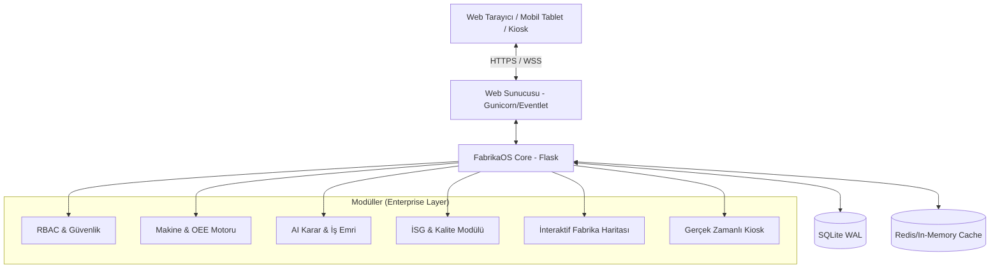
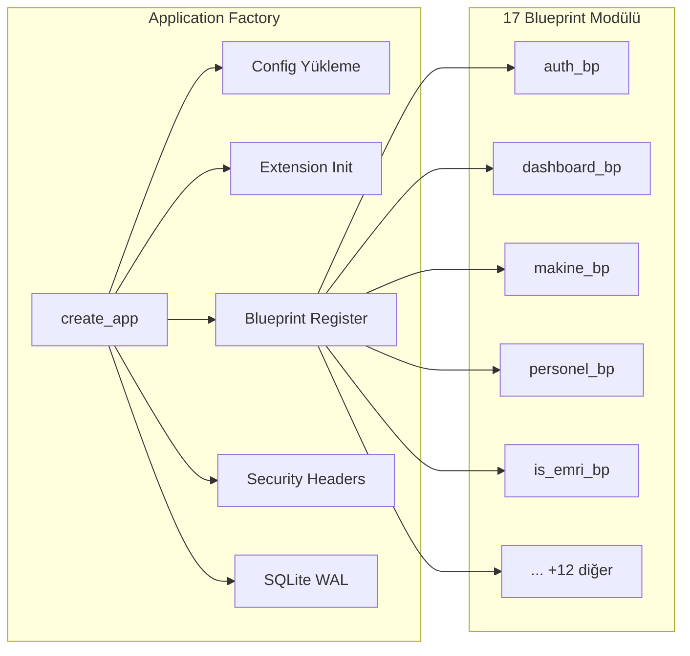
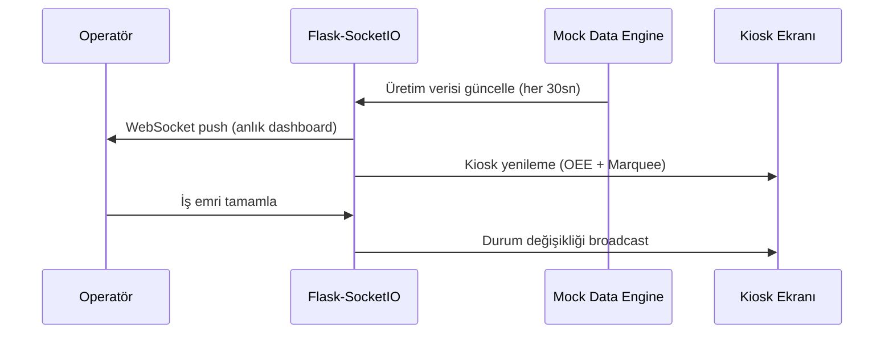
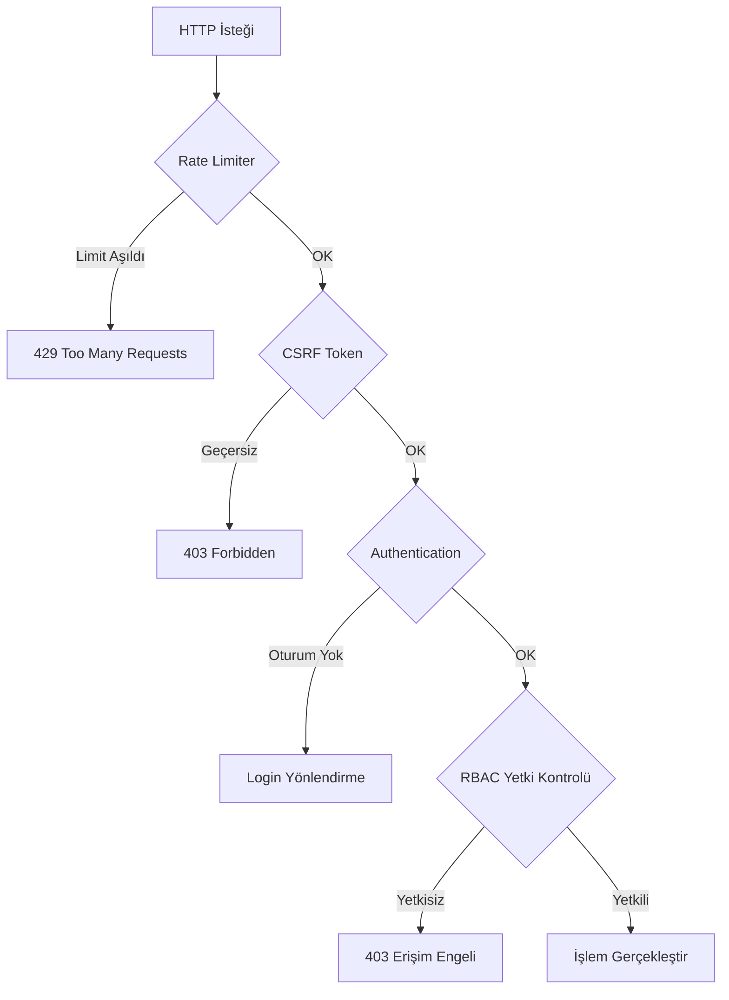

<div align="center">
  

  # FabrikaOS (FDYS)
  ### Kurumsal Kaynak ve Dijital Üretim Yönetim Sistemi
  
  *Endüstri 4.0 standartlarında, metal sektörü odaklı, yapay zeka destekli akıllı fabrika yönetim platformu.*

  [](https://www.python.org/)
  [](https://flask.palletsprojects.com/)
  [](https://sqlite.org/)
  [](https://getbootstrap.com/)
  [](#)
</div>

---

## 🌟 Vizyonumuz: Geleceğin Fabrikasını Bugünden İnşa Etmek

**FabrikaOS**, geleneksel üretim süreçlerini dijitalleştirerek görünürlük, verimlilik ve kontrol sağlayan **yeni nesil bir MES (Üretim Yönetim Sistemi) ve ERP (Kurumsal Kaynak Planlama)** hibrit çözümüdür. Özellikle **Metal Sanayisi** ve ağır sanayi gereksinimleri göz önünde bulundurularak optimize edilmiş olan bu sistem; yöneticilere 360 derece veri sunarken, operatörlere ve teknisyenlere sahada hız kazandırır.

B2B kurumsal vizyona uygun karanlık teması (Dark Mode) ve "Glassmorphism" odaklı estetik arayüzü ile kullanıcılarına yalnızca işlevsel değil, **görsel olarak da premium bir deneyim** yaşatır.

---

## 🚀 Öne Çıkan Kurumsal Özellikler

Sistem, modern endüstrinin ihtiyaçlarını karşılayacak şekilde ölçeklenebilir ve sağlam bir altyapı üzerine kurulmuştur.

### 🤖 Yapay Zeka & Tahminleme Motoru
- **Kestirimci Bakım:** Makine kullanım verilerine dayanarak gelecekteki olası arızaları tahmin eder.
- **AI Operatör Önerisi:** İş emrinin niteliğine (zorluk, gereken beceri seti) ve operatörlerin geçmiş performanslarına (OEE, hata oranı) göre en uygun personeli yapay zeka ile eşleştirir.
- **OEE Trend Analizi:** Son 30 günlük verileri analiz ederek gelecekteki verimlilik düşüşlerini proaktif olarak bildirir.

### 🏭 İnteraktif & Dijital İkiz Destekli Fabrika Haritası
- Sahadaki makinelerin durumunu (Çalışıyor, Durdu, Arızalı) canlı olarak SVG tabanlı **İnteraktif Fabrika Haritası** üzerinde gösterir.
- Tamamen sürükle-bırak (Drag & Drop) desteği ile makine yerleşimlerini dijital ortama taşır.
- CSS çakışmalarından arındırılmış, pürüzsüz donanım hızlandırmalı transform animasyonları barındırır.

### 📊 Gerçek Zamanlı Kiosk ve OEE Takibi
- Fabrika zemininde dev ekranlarda gösterilmek üzere tasarlanmış, **otomatik yenilenen Kiosk Modu**.
- Makinelerin Kullanılabilirlik (Availability), Performans (Performance) ve Kalite (Quality) verilerini hesaplayan **Dinamik OEE Motoru**.
- Socket.IO mimarisi sayesinde anlık veri akışı ve "Marquee" (Kayan yazı) şeklinde acil durum bildirimleri.

### 🛡️ Kurumsal Güvenlik ve RBAC (Rol Bazlı Erişim)
- Yönetici (Admin), Operatör ve Teknisyen için sıkı bir şekilde izole edilmiş yetkilendirme sistemi.
- OWASP standartlarında güvenlik: CSRF koruması, Rate Limiting (Flask-Limiter), güvenli oturum yönetimi ve SQL Injection önlemleri.
- Veri bütünlüğünü sağlamak adına SQLite WAL (Write-Ahead Logging) üretim modu aktivasyonu.

---

## 🏗️ Sistem Mimarisi



---

## 📦 Kurulum ve Çalıştırma

Geliştirme veya demo ortamınızı saniyeler içinde ayağa kaldırın:

### 1. Depoyu Klonlayın
```bash
git clone https://github.com/Scryne/FabrikaOS.git
cd FabrikaOS
```

### 2. Sanal Ortam ve Bağımlılıklar
```bash
python -m venv venv
# Windows:
venv\Scripts\activate
# Linux/Mac:
# source venv/bin/activate

pip install -r requirements.txt
```

### 3. Çevre Değişkenleri (.env)
Kök dizinde `.env` dosyasını oluşturun:
```ini
FLASK_APP=run.py
FDYS_CONFIG=development
SECRET_KEY=super-gizli-kurumsal-anahtar-123
```

### 4. Veritabanı ve Seed Verileri
Sistemin çalışması için gerekli tabloları ve demo (Metal sektörü) verilerini oluşturun:
```bash
flask db upgrade
python seed_data.py
```

### 5. Sunucuyu Başlatın
```bash
python run.py
```
Sistem `http://localhost:5000` adresinde aktif olacaktır.

---

### 🔑 Giriş Bilgileri (Demo Hesapları)

Sistemi çalıştırdıktan sonra, rol bazlı erişim mekanizmasını (RBAC) ve her role özel tasarlanmış dashboard panellerini test etmek için aşağıdaki ön tanımlı hesapları kullanabilirsiniz:

#### 1. Sistem Yöneticisi (Admin)
- **Kullanıcı Adı:** `admin`
- **Şifre:** `admin123`
- **Rolü:** Yönetici (Admin)
- **Erişebildiği Modüller:** Tüm modüller, Sistem Ayarları, Raporlar, AI Tahminleme, Gelişmiş Analitik.

#### 2. Operatörler (Üretim Girişi ve İzin Talepleri İçin)
- **Hesap 1 (Kıdemli Operatör)**
  - **Kullanıcı Adı:** `ahmet.yilmaz`
  - **Şifre:** `demo123`
  - **Erişebildiği Modüller:** Personel, Makine & Üretim, Stok, Kalite
- **Hesap 2 (Operatör)**
  - **Kullanıcı Adı:** `fatma.demir`
  - **Şifre:** `demo123`
  - **Erişebildiği Modüller:** Personel, Makine & Üretim, Stok

#### 3. Teknisyenler (Bakım ve Arıza Takibi İçin)
- **Hesap 1 (Kıdemli Teknisyen)**
  - **Kullanıcı Adı:** `mehmet.kaya`
  - **Şifre:** `demo123`
  - **Erişebildiği Modüller:** Makine & Üretim, İSG
- **Hesap 2 (Elektrik Teknisyeni)**
  - **Kullanıcı Adı:** `ayse.ozkan`
  - **Şifre:** `demo123`
  - **Erişebildiği Modüller:** Makine & Üretim, Enerji, İSG

---

## 🎨 UI/UX Tasarım Dili: "Metal" Teması
FabrikaOS, metal sanayisinin güçlü ve ağır yapısını yansıtan, profesyonel B2B sunumlarına tam uyumlu **premium dark mode** tasarım diline sahiptir.
- Derin lacivert ve siyah tonlarının karışımı (`#0f172a`, `#1e293b`).
- Mavi neon ve cam efektleri (Glassmorphism) ile desteklenmiş vurgular.
- Göz yormayan kontrast ayarları ve profesyonel tipografi.

---

## 🤝 Katkıda Bulunma & Geliştirme Standartları

Bu proje, yüksek kurumsal kalite standartlarına göre sürdürülmektedir. Pull Request (PR) oluşturmadan önce:
1. Kodun mevcut mimari yaklaşımlara (Blueprints, Flask MVC) uygun olduğundan emin olun.
2. Pytest üzerinden tüm entegrasyon testlerinin geçtiğini doğrulayın: `pytest tests/ -v`.
3. Yeni özellikler eklerken responsive tasarım kurallarına uyun.

---

---

<div align="center">

# 📽️ PROJE SUNUM DOSYASI

### FabrikaOS — Kapsamlı Proje Sunumu
*Bu bölüm, FabrikaOS projesinin teknik mimarisini, modül yapısını ve kurumsal özelliklerini detaylı şekilde açıklamak üzere hazırlanmıştır.*

</div>

---

## 📌 1. Proje Tanıtımı ve Problem Tanımı

### 1.1. Problem

Türkiye'deki metal sanayi ve ağır sanayi tesislerinin büyük çoğunluğu hâlâ **kâğıt tabanlı**, **Excel'e bağımlı** ve **birbirinden kopuk** süreçlerle yönetilmektedir. Bu durum:

| Problem | Sonuç |
|---------|-------|
| Manuel üretim takibi | Veri kaybı, gecikmiş raporlar |
| Reaktif bakım anlayışı | Beklenmedik duruşlar, yüksek maliyet |
| Dağınık kalite kontrol | Müşteri şikâyetleri, fire artışı |
| Görünürlük eksikliği | Yönetim kararlarının sezgisel kalması |
| İSG takibinin yetersizliği | İş kazaları, yasal cezalar |

### 1.2. Çözüm: FabrikaOS

**FabrikaOS**, yukarıdaki tüm sorunları **tek bir platformda** çözen, **Endüstri 4.0** standartlarında geliştirilmiş bir **MES + ERP hibrit çözümüdür**.

> **Vizyon:** *Geleneksel üretim tesislerini, yapay zeka destekli dijital fabrikalara dönüştürmek.*

### 1.3. Hedef Sektör ve Kullanıcı Profili

- **Birincil Sektör:** Metal Sanayi (Otomotiv Yan Sanayi, CNC İşleme, Dövme-Döküm)
- **Ölçek:** 50-500 çalışanlı KOBİ ve orta ölçekli üretim tesisleri
- **Kullanıcılar:** Fabrika Müdürleri, Üretim Planlamacılar, Operatörler, Bakım Teknisyenleri, İSG Uzmanları

---

## 🏛️ 2. Teknik Mimari

### 2.1. Teknoloji Yığını (Tech Stack)

```
┌─────────────────────────────────────────────────────────────┐
│                      FRONTEND KATMANI                       │
├─────────────────────────────────────────────────────────────┤
│  HTML5 + Jinja2 Templating Engine                           │
│  CSS3 (Custom Dark Theme - "Metal" Design Language)         │
│  Bootstrap 5.3 (Responsive Grid & Components)               │
│  Chart.js (Dinamik Grafikler & OEE Göstergeleri)            │
│  Vanilla JS + Socket.IO Client (Gerçek Zamanlı UI)          │
│  SVG (İnteraktif Fabrika Haritası & Dijital İkiz)           │
├─────────────────────────────────────────────────────────────┤
│                      BACKEND KATMANI                        │
├─────────────────────────────────────────────────────────────┤
│  Python 3.12+                                               │
│  Flask 3.1.1 (Application Factory Pattern)                  │
│  Flask-SQLAlchemy 3.1.1 (ORM)                               │
│  Flask-SocketIO 5.5.1 + Eventlet (WebSocket)                │
│  Flask-Login (Session & RBAC)                               │
│  Flask-Bcrypt (Parola Hashleme)                             │
│  Flask-WTF + CSRFProtect (Form Güvenliği)                   │
│  Flask-Limiter (Brute-Force Koruması)                       │
│  Flask-Caching (Performans Optimizasyonu)                   │
│  Flask-Migrate / Alembic (DB Migrasyon)                     │
├─────────────────────────────────────────────────────────────┤
│                    VERİTABANI KATMANI                        │
├─────────────────────────────────────────────────────────────┤
│  SQLite (WAL Mode) — Geliştirme & Demo                      │
│  PostgreSQL — Üretim Ortamı Desteği (psycopg2)              │
│  18+ İlişkisel Tablo, Foreign Key Bütünlüğü                │
├─────────────────────────────────────────────────────────────┤
│                   YAPAY ZEKA KATMANI                         │
├─────────────────────────────────────────────────────────────┤
│  NumPy 2.2.5 (Veri İşleme)                                 │
│  scikit-learn 1.6.1 (ML Modelleri)                          │
│  Kestirimci Bakım, Anomali Tespiti, OEE Tahmin, Stok Tahmin│
└─────────────────────────────────────────────────────────────┘
```

### 2.2. Mimari Desen: Application Factory + Blueprint MVC



**Neden Application Factory?**
- ✅ Test, geliştirme ve üretim ortamları aynı kod tabanıyla çalışır
- ✅ Döngüsel import sorunları önlenir
- ✅ Her ortam için farklı yapılandırma (`DevelopmentConfig`, `ProductionConfig`, `TestingConfig`)

### 2.3. Veritabanı Şeması (ER Özeti)

Sistem **18+ ilişkisel tablodan** oluşmaktadır:

| Modül | Tablolar | Açıklama |
|-------|----------|----------|
| **Kullanıcı & Personel** | `Kullanici`, `Calisan`, `VardiyaPlani`, `IzinTalebi` | RBAC, vardiya yönetimi |
| **Makine & Üretim** | `Makine`, `UretimVerisi`, `ArizaKaydi` | OEE hesaplamalı üretim takibi |
| **Stok** | `Malzeme`, `StokHareketi`, `Tedarikci` | Tedarik zinciri yönetimi |
| **Kalite** | `HataKaydi`, `DuzelticiFaaliyet` | CAPA düzeltici eylemler |
| **Enerji** | `EnerjiTuketimi` | Makine bazlı tüketim izleme |
| **İSG** | `IsKazasi`, `RiskDegerlendirme`, `IsgEgitimi` | İş güvenliği & eğitim |
| **İş Emri** | `IsEmri`, `IsEmriYorum` | SLA takipli iş yönetimi |
| **Kurumsal** | `KurumsalAyarlar` | Çoklu şirket desteği |
| **AI & Analitik** | `KPI Hedefleri`, `Tahmin Kayıtları` | 11 KPI × 12 ay, 14 tahmin |

### 2.4. Gerçek Zamanlı İletişim Mimarisi



---

## ⚙️ 3. Modül Detayları

### 3.1. 🤖 Yapay Zeka & Tahminleme Motoru

FabrikaOS, **4 ayrı AI motoru** barındırır:

| AI Modülü | Algoritma | İşlev |
|-----------|-----------|-------|
| **Kestirimci Bakım** | Regresyon + Trend Analizi | Makine arıza olasılığını önceden tahmin eder |
| **Anomali Tespiti** | İstatistiksel Sapma Analizi | Üretim verilerindeki anormallikleri yakalar |
| **OEE Tahmin** | Zaman Serisi Analizi | Gelecek dönem verimlilik öngörüsü sunar |
| **Stok Tahmin** | Tüketim Trendi Modeli | Kritik stok seviyelerini önceden bildirir |

**AI Operatör Önerisi:** İş emri oluşturulurken, operatörlerin geçmiş performansı (OEE, hata oranı) ve iş emrinin gereksinimleri (zorluk, beceri seti) analiz edilerek en uygun personel **yapay zeka ile eşleştirilir**.

### 3.2. 🏭 İnteraktif Fabrika Haritası (Dijital İkiz)

- **SVG tabanlı** gerçek zamanlı fabrika görselleştirmesi
- **Sürükle-Bırak** ile makine konumlandırma
- Makine durumları renk kodlu: 🟢 Çalışıyor | 🟡 Durdu | 🔴 Arızalı
- Donanım hızlandırmalı CSS transform animasyonları
- Hover ile anlık makine detay kartları

### 3.3. 📊 OEE Motoru & Kiosk Modu

**OEE (Overall Equipment Effectiveness)** hesaplama formülü:

```
OEE = Kullanılabilirlik × Performans × Kalite

Kullanılabilirlik = (Planlanan Üretim - Duruş Süresi) / Planlanan Üretim
Performans        = (Gerçekleşen Üretim × İdeal Çevrim) / Çalışma Süresi  
Kalite             = (Toplam Üretim - Fire) / Toplam Üretim
```

**Kiosk Modu Özellikleri:**
- Fabrika zemininde dev ekranlar için optimize edilmiş tam ekran görünüm
- Otomatik yenilenen (auto-refresh) canlı veriler
- Kayan yazı (Marquee) ile acil durum bildirimleri
- Socket.IO ile anlık veri akışı

### 3.4. 📋 İş Emri Yönetimi

- Öncelik seviyeleri: Düşük → Orta → Yüksek → Kritik
- **SLA (Service Level Agreement)** takibi ile süre aşımı bildirimleri
- İş emri yorumları ve aktivite geçmişi
- AI destekli operatör atama önerisi
- Durum akışı: `Oluşturuldu → Atandı → Devam Ediyor → Tamamlandı`

### 3.5. 📈 Gelişmiş Analitik & Raporlama

| Analitik Servisi | Açıklama |
|------------------|----------|
| **KPI Servisi** | 11 temel KPI metriğini 12 aylık hedeflerle karşılaştırır |
| **Korelasyon Analizi** | Üretim parametreleri arasındaki ilişkileri keşfeder |
| **Karşılaştırma** | Makine-makine, vardiya-vardiya performans kıyaslaması |
| **Maliyet Analizi** | Üretim maliyeti, bakım maliyeti, enerji maliyeti dağılımı |

**Rapor Çıktıları:**
- 📄 PDF rapor oluşturma (ReportLab)
- 📊 Excel rapor dışa aktarma (openpyxl)
- 📈 Etkileşimli Chart.js grafikleri

### 3.6. 🛡️ İş Sağlığı ve Güvenliği (İSG)

- İş kazası ve ramak kala olay kayıtları
- Risk değerlendirme matrisi (Olasılık × Şiddet)
- İSG eğitim takibi ve sertifika yönetimi
- Risk puanlama servisi ile otomatik önceliklendirme

### 3.7. 🔌 Enerji Yönetimi

- Makine bazlı enerji tüketim izleme (kWh)
- 5 farklı enerji türü takibi (Elektrik, Doğalgaz, Basınçlı Hava vb.)
- Aylık/yıllık tüketim trend analizi
- Enerji maliyeti raporlama

### 3.8. 📦 Stok & Tedarik Zinciri

- Malzeme giriş-çıkış hareketleri
- Kritik stok seviyesi uyarıları
- 7 tedarikçi, 12 malzeme, 18 hareket kaydı (demo)
- AI destekli stok tüketim tahmini

---

## 🔒 4. Güvenlik Mimarisi

FabrikaOS, **OWASP Top 10** standartlarına uygun güvenlik katmanlarıyla donatılmıştır:



| Güvenlik Katmanı | Teknoloji | Açıklama |
|-------------------|-----------|----------|
| **Kimlik Doğrulama** | Flask-Login + Bcrypt | Güçlü session, parola hashleme |
| **RBAC** | 3 Rol (Admin, Operatör, Teknisyen) | İzole yetkilendirme |
| **CSRF** | Flask-WTF CSRFProtect | Tüm formlarda token doğrulama |
| **Rate Limiting** | Flask-Limiter | Brute-force saldırı önleme |
| **Security Headers** | Custom Middleware | X-Frame, HSTS, CSP, XSS Protection |
| **Veri Bütünlüğü** | SQLite WAL + FK | Write-Ahead Logging, Foreign Key |
| **Session** | HTTPOnly + SameSite=Lax | Cookie güvenliği |

---

## 🧩 5. Proje Yapısı

```
FabrikaOS/
├── app/
│   ├── __init__.py              # Application Factory
│   ├── extensions.py            # Flask uzantı tanımları
│   ├── models/                  # 15 veri modeli (SQLAlchemy ORM)
│   │   ├── kullanici.py         #   Kullanıcı & RBAC
│   │   ├── makine.py            #   Makine, Üretim, Arıza, Bakım, Duruş
│   │   ├── personel.py          #   Çalışan, Vardiya, İzin
│   │   ├── is_emri.py           #   İş emri & yorumlar
│   │   ├── kalite.py            #   Hata & CAPA
│   │   ├── stok.py              #   Malzeme, Hareket, Tedarikçi
│   │   ├── enerji.py            #   Enerji tüketimi
│   │   ├── isg.py               #   İş kazası, Risk, Eğitim
│   │   └── analitik.py          #   KPI hedefleri & tahminler
│   ├── routes/                  # 17 Blueprint (URL & Controller)
│   │   ├── auth.py              #   Giriş/Çıkış
│   │   ├── dashboard.py         #   Rol bazlı dashboard'lar
│   │   ├── makine.py            #   Makine CRUD & OEE
│   │   ├── personel.py          #   Personel yönetimi
│   │   ├── is_emri.py           #   İş emri CRUD
│   │   ├── fabrika_harita.py    #   İnteraktif harita
│   │   ├── tahmin.py            #   AI tahminleme arayüzü
│   │   ├── analitik.py          #   Gelişmiş analitik
│   │   ├── rapor.py             #   PDF/Excel raporlama
│   │   ├── admin.py             #   Yönetici paneli
│   │   └── ...                  #   +7 diğer modül
│   ├── services/                # İş mantığı servisleri
│   │   ├── ai/                  #   4 AI motoru
│   │   │   ├── kestirimci_bakim.py
│   │   │   ├── anomali_tespit.py
│   │   │   ├── oee_tahmin.py
│   │   │   └── stok_tahmin.py
│   │   ├── analitik/            #   4 analitik servisi
│   │   │   ├── kpi_servisi.py
│   │   │   ├── korelasyon.py
│   │   │   ├── karsilastirma.py
│   │   │   └── maliyet_servisi.py
│   │   ├── tahmin_motoru.py     #   Ana tahmin orkestratörü
│   │   ├── otomasyon_motoru.py  #   Otomasyon kuralları
│   │   ├── bildirim_motoru.py   #   Bildirim sistemi
│   │   ├── oee_hesaplama.py     #   OEE formül motoru
│   │   └── mock_engine.py       #   Canlı demo veri üreteci
│   ├── templates/               # 19 template dizini (Jinja2)
│   ├── static/                  # CSS, JS, görseller
│   └── forms/                   # WTForms form sınıfları
├── seeds/                       # 13 modül demo verisi
├── migrations/                  # Alembic DB migration'ları
├── tests/                       # Pytest test suite
├── config.py                    # 3 ortam yapılandırması
├── run.py                       # Uygulama giriş noktası
├── seed_data.py                 # Demo veri orkestratörü
└── requirements.txt             # 25+ Python bağımlılığı
```

---

## 📊 6. Demo Senaryosu

Demo ortamı, gerçekçi bir **metal sanayi tesisi** senaryosunu simüle eder:

> **Şirket:** AnadoluTech Metal Sanayi A.Ş.  
> **Konum:** Kocaeli Organize Sanayi Bölgesi  
> **Sektör:** Otomotiv Yan Sanayi — CNC İşleme & Metal Şekillendirme

### Yüklenen Demo Verileri

| Veri Seti | Miktar | Detay |
|-----------|--------|-------|
| Kullanıcılar | 5 hesap | 1 Admin + 2 Operatör + 2 Teknisyen |
| Çalışanlar | 15 kişi | Farklı departman ve beceri setleri |
| Makine Parkı | 6 makine | CNC Torna, Freze, Pres, Kaynak vb. |
| Üretim Verileri | 180 gün | 3 vardiya, OEE hesaplamalı |
| Arıza Kayıtları | 8 kayıt | Açık + çözülmüş |
| Bakım Kayıtları | 9 kayıt | Periyodik + korektif |
| Stok | 12 malzeme | 7 tedarikçi, 18 hareket |
| Kalite | 8 hata | 5 CAPA düzeltici faaliyet |
| Enerji | 5 ay | 5 tür, makine bazlı |
| İSG | 25 kayıt | 5 kaza, 8 risk, 12 eğitim |
| İş Emirleri | 10 emir | 5 yorum, SLA takipli |
| KPI Hedefleri | 132 kayıt | 11 KPI × 12 ay |
| AI Tahminleri | 14 tahmin | Bakım, OEE, stok, anomali |

---

## 🎨 7. UI/UX Tasarım Felsefesi

### "Metal" Tasarım Dili

FabrikaOS, **B2B kurumsal satış sunumlarına** tam uyumlu, sektör kimliğini yansıtan bir arayüze sahiptir:

```
Renk Paleti:
──────────────────────────────
▓▓▓▓ #0f172a  → Ana Arka Plan (Derin Lacivert-Siyah)
▓▓▓▓ #1e293b  → Kart Arka Planı
▓▓▓▓ #334155  → Kenarlıklar
▓▓▓▓ #38bdf8  → Birincil Vurgu (Neon Mavi)
▓▓▓▓ #10b981  → Başarı Durumu (Yeşil)
▓▓▓▓ #f59e0b  → Uyarı (Amber)
▓▓▓▓ #ef4444  → Hata / Kritik (Kırmızı)
──────────────────────────────
```

- **Glassmorphism:** Yarı saydam kartlar, blur efektleri
- **Dark Mode:** Göz yormayan, 7/24 fabrika ortamına uygun
- **Responsive:** Masaüstü, tablet ve kiosk ekranlarına uyumlu
- **Mikro-animasyonlar:** Hover efektleri, geçiş animasyonları

---

## 📈 8. Rekabet Avantajları

| Özellik | FabrikaOS | Geleneksel ERP | Rakip MES |
|---------|:---------:|:--------------:|:---------:|
| Yapay Zeka Tahminleme | ✅ | ❌ | ⚠️ Kısıtlı |
| Gerçek Zamanlı (WebSocket) | ✅ | ❌ | ⚠️ Polling |
| İnteraktif Fabrika Haritası | ✅ | ❌ | ❌ |
| Kiosk Modu | ✅ | ❌ | ⚠️ Ek Modül |
| Rol Bazlı Dashboard | ✅ 3 Rol | ⚠️ Tek Panel | ⚠️ 2 Rol |
| Metal Sektör Optimizasyonu | ✅ | ❌ Genel | ❌ Genel |
| Türkçe Tam Destek | ✅ | ⚠️ Kısıtlı | ❌ |
| Kurulum Kolaylığı | ✅ 5 dk | ❌ Haftalarca | ❌ Günlerce |
| Açık Kaynak Esnekliği | ✅ | ❌ Kapalı | ❌ Lisanslı |

---

## 🔮 9. Gelecek Yol Haritası (Roadmap)

```mermaid
gantt
    title FabrikaOS Geliştirme Yol Haritası
    dateFormat YYYY-Q
    axisFormat %Y-Q%q

    section v1.0 (Mevcut)
    Çekirdek MES + ERP Modülleri        :done, 2026-Q1, 2026-Q2
    AI Tahminleme Motoru                :done, 2026-Q1, 2026-Q2
    İnteraktif Fabrika Haritası         :done, 2026-Q1, 2026-Q2

    section v1.5 (Planlanan)
    REST API Katmanı                    :active, 2026-Q3, 2026-Q3
    Mobil Uygulama (PWA)                :2026-Q3, 2026-Q4
    Çoklu Dil Desteği (i18n)            :2026-Q3, 2026-Q4

    section v2.0 (Vizyon)
    IoT Sensör Entegrasyonu             :2026-Q4, 2027-Q1
    Docker + Kubernetes Deployment      :2026-Q4, 2027-Q1
    Gelişmiş ML Pipeline                :2027-Q1, 2027-Q2
```

### Planlanan Geliştirmeler

- 🔌 **REST API:** Üçüncü parti sistemlerle entegrasyon katmanı
- 📱 **PWA Mobil:** Saha operatörleri için Progressive Web App
- 🌐 **i18n:** Çoklu dil desteği (İngilizce, Almanca)
- 🔗 **IoT Gateway:** PLC ve sensörlerden doğrudan veri toplama
- 🐳 **Konteynerizasyon:** Docker Compose ile tek komutla deployment
- 🧠 **Gelişmiş ML:** Derin öğrenme tabanlı tahminleme pipeline

---

## 🏆 10. Sonuç

**FabrikaOS**, metal sanayi tesislerinin dijital dönüşüm ihtiyacını karşılamak üzere sıfırdan tasarlanmış, **modüler**, **ölçeklenebilir** ve **yapay zeka destekli** bir üretim yönetim platformudur.

<div align="center">

### 🎯 Temel Değer Önerisi

| Metrik | Hedef |
|--------|-------|
| ⏱️ Plansız Duruş Süresinde Azalma | **%30+** |
| 📈 OEE Artışı | **%15-25** |
| 🔧 Bakım Maliyetinde Düşüş | **%20+** |
| 📋 Raporlama Süresinde Kısalma | **%80+** |
| 🛡️ İSG Uyum Oranı | **%100** |

---

*"FabrikaOS ile üretim verileri artık bir yük değil, stratejik bir güç."*

</div>

---

<div align="center">
  <strong>© 2026 FabrikaOS - Dijital Dönüşümün Kalbi.</strong> <br>
  <em>Geliştirici: <a href="https://github.com/Scryne">Scryne</a></em>
</div>
