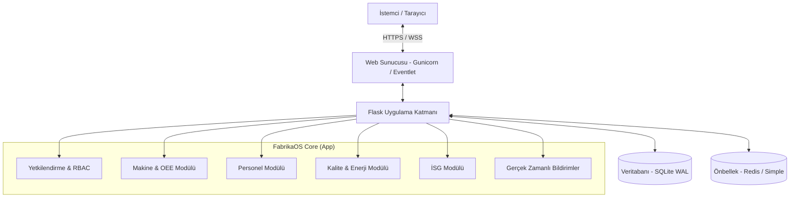

<div align="center">
  

  # FabrikaOS (FDYS)
  **Geleceğin Dijital Fabrika Yönetim Sistemi**

  [](https://www.python.org/downloads/)
  [](https://flask.palletsprojects.com/)
  [](https://opensource.org/licenses/MIT)
  [](#)

  *Kapsamlı, Gerçek Zamanlı, Modüler ve Ölçeklenebilir Endüstri 4.0 Platformu*
</div>

---

## 🌟 Vizyon ve Misyon

**FabrikaOS (FDYS)**, modern üretim tesislerinin kağıt tabanlı hantal süreçlerden kurtulup, tamamen dijital, şeffaf ve ölçülebilir bir yapıya geçişini sağlayan "Kurumsal Kaynak Yönetimi ve Üretim Takip" sistemidir. Makine verilerinden personel takibine, enerji tüketiminden İSG risk analizlerine kadar bir fabrikanın tüm can damarlarını tek bir platformda birleştirir.

## 🚀 Öne Çıkan Özellikler (Faz 6 - Enterprise Edition)

Sistem 6 farklı büyüme aşamasından (Faz) geçmiş ve günümüzdeki kusursuz kurumsal yapısına kavuşmuştur.

*   🔐 **Gelişmiş Rol Bazlı Erişim (RBAC):** Yönetici, Operatör ve Teknisyen için izole edilmiş, güvenli yetkilendirme altyapısı.
*   ⚡ **Gerçek Zamanlı İletişim:** Socket.IO destekli anlık bildirim motoru (Örn: Makine arızalandığında saniyeler içinde uyarı).
*   🤖 **Yapay Zeka Destekli Karar Mekanizması:** OEE tahmini, anomali tespiti ve kestirimci bakım önerileri.
*   📊 **Dinamik OEE Hesaplamaları & Gelişmiş Analitik:** Kullanılabilirlik, Performans ve Kalite oranlarını anlık hesaplayan, çapraz modül korelasyon analizleri sunan motor.
*   🛡️ **Kurumsal Güvenlik (OWASP Standartları):** Flask-Limiter, CSRF koruması, Güvenli Çerezler (Secure Cookies) ve SQL Enjeksiyonlarına karşı tam koruma.
*   🎨 **Premium UI/UX (Koyu Tema):** B2B kurumsal vizyona uygun, modern, animasyonlu ve karanlık tema (dark mode) odaklı estetik arayüz.

## 🏗️ Sistem Mimarisi



## 🛠️ Teknoloji Yığını

- **Backend:** Python 3.12, Flask, Flask-SQLAlchemy, Flask-SocketIO, Flask-Caching
- **Frontend:** HTML5, CSS3 (Custom Glassmorphism), Bootstrap 5.3, Vanilla JS
- **Veritabanı:** SQLite (WAL Modu aktif - Production Ready)
- **Güvenlik:** Flask-Limiter, Flask-Bcrypt, CSRFProtect
- **Test:** Pytest, pytest-flask (12/12 Test Pass Rate)

## 📦 Kurulum ve Çalıştırma

Sistemi kendi ortamınızda ayağa kaldırmak oldukça basittir:

### 1. Depoyu Klonlayın
```bash
git clone https://github.com/Scryne/FabrikaOS.git
cd FabrikaOS
```

### 2. Sanal Ortam Oluşturun ve Bağımlılıkları Yükleyin
```bash
python -m venv venv
# Windows için:
venv\Scripts\activate
# Linux/Mac için:
# source venv/bin/activate

pip install -r requirements.txt
```

### 3. Çevre Değişkenlerini (Env) Ayarlayın
Kök dizinde bir `.env` dosyası oluşturun ve gizli anahtarlarınızı tanımlayın:
```ini
FLASK_APP=run.py
FDYS_CONFIG=development
SECRET_KEY=super-gizli-guvenli-anahtar
```

### 4. Veritabanını Başlatın ve Örnek Veri Ekleyin
```bash
flask db upgrade
python seed_data.py
```

### 5. Uygulamayı Çalıştırın
```bash
python run.py
```
Tarayıcınızdan `http://localhost:5000` adresine giderek sistemi kullanmaya başlayabilirsiniz.

### 🔑 Giriş Bilgileri (Demo Hesapları)

Sistemi çalıştırdıktan sonra, rol bazlı erişim mekanizmasını (RBAC) ve her role özel tasarlanmış dashboard panellerini test etmek için aşağıdaki ön tanımlı hesapları kullanabilirsiniz:

#### 1. Sistem Yöneticisi (Admin)
- **Kullanıcı Adı:** `admin`
- **Şifre:** `admin123`
- **Rolü:** Yönetici (Admin)
- **Erişebildiği Modüller:** Tüm modüller, Sistem Ayarları, Raporlar, AI Tahminleme, Gelişmiş Analitik.

#### 2. Operatörler (Üretim Girişi ve İzin Talepleri İçin)
- **Hesap 1 (Kıdemli Operatör)**
  - **Kullanıcı Adı:** `ahmet.yilmaz`
  - **Şifre:** `demo123`
  - **Erişebildiği Modüller:** Personel, Makine & Üretim, Stok, Kalite
- **Hesap 2 (Operatör)**
  - **Kullanıcı Adı:** `fatma.demir`
  - **Şifre:** `demo123`
  - **Erişebildiği Modüller:** Personel, Makine & Üretim, Stok

#### 3. Teknisyenler (Bakım ve Arıza Takibi İçin)
- **Hesap 1 (Kıdemli Teknisyen)**
  - **Kullanıcı Adı:** `mehmet.kaya`
  - **Şifre:** `demo123`
  - **Erişebildiği Modüller:** Makine & Üretim, İSG
- **Hesap 2 (Elektrik Teknisyeni)**
  - **Kullanıcı Adı:** `ayse.ozkan`
  - **Şifre:** `demo123`
  - **Erişebildiği Modüller:** Makine & Üretim, Enerji, İSG

## 🧪 Testleri Çalıştırma

Projenin güvenilirliğini doğrulamak için entegre pytest paketini kullanabilirsiniz:
```bash
pytest tests/ -v
```

## 🤝 Katkıda Bulunma

Bu projenin gelişimi tamamen kurumsal prensiplere göre yürütülmektedir. Pull Request (PR) göndermeden önce lütfen tüm testlerin (`pytest`) geçtiğinden ve kod yapısının mevcut profesyonel standartlara (`PEP 8`) uygun olduğundan emin olun.

---

## 🗺️ Geliştirme Yol Haritası (v2.0 — Üst Seviye Yükseltme)

FabrikaOS'u rakipsiz bir endüstri platformuna dönüştürmek için planlanan özellikler aşağıda **3 dalga** halinde listelenmiştir. Her özellik tamamlandığında işaretlenecektir.

### 🧠 Kategori 1 — Yapay Zeka Destekli Tahminleme Motoru

> Türkiye'de bu fiyat segmentinde AI destekli fabrika yazılımı **yok**. Bu kategori tek başına projeyi tüm KOBİ yazılımlarından ayırır.

#### 1.1 Predictive Maintenance (Kestirimci Bakım)
Mevcut bakım takvimi sabit periyotlara dayalı. Geçmiş arıza/bakım verisini analiz ederek:
- [x] **Arıza olasılığı tahmini**: "Bu makine 12 gün içinde arıza yapma olasılığı %78"
- [x] **Bakım zamanlaması optimizasyonu**: Makine kullanım yoğunluğuna göre dinamik bakım tarihi
- [x] **Teknik**: `scikit-learn` ile regresyon modeli — eğitim verisi mevcut tablolardan sağlanır

#### 1.2 OEE Trend Tahmini
- [x] Son 30 günlük OEE verisinden **gelecek 7 gün tahmini** (moving average + trend analizi)
- [x] "OEE bu gidişle 2 hafta içinde hedefinizin altına düşecek" gibi **proaktif uyarılar**
- [x] Dashboard'da tahmin çizgisi olarak gösterim (kesikli çizgi)

#### 1.3 Stok Tükenme Tahmini
- [x] Tüketim hızına göre **"Bu malzeme X gün sonra tükenecek"** tahmini
- [x] Tedarikçi teslimat süresini hesaba katarak **sipariş zamanı önerisi**

#### 1.4 Anomali Tespiti
- [x] Enerji tüketiminde anormal artış algılama
- [x] Üretim kalitesinde sapma tespiti
- [x] **Teknik**: Z-score veya IQR tabanlı basit anomali algılama

---

### 🗺️ Kategori 2 — İnteraktif Fabrika Haritası (Dijital İkiz Lite)

> Demo'da en çok "WOW" etkisi yaratacak özellik.

#### 2.1 Canlı Fabrika Yerleşim Planı
- [x] SVG tabanlı 2D fabrika haritası (üstten bakış)
- [x] Her makine harita üzerinde renk kodlu düğüm: 🟢 Çalışıyor, 🟡 Bakımda, 🔴 Arızalı, ⚫ Kapalı
- [x] Makine üzerine hover → mini popup (OEE, son arıza, operatör bilgisi)
- [x] Tıklama → makine detay sayfasına yönlendirme

#### 2.2 Isı Haritası Katmanları
- [ ] **Enerji ısı haritası**: Hangi bölge ne kadar enerji harcıyor
- [ ] **Risk ısı haritası**: İSG risk puanlarına göre tehlikeli bölgeler
- [ ] **Kalite ısı haritası**: Hangi hatta/bölgede daha çok hata çıkıyor

#### 2.3 Teknik Altyapı
- [x] Makine modeline `konum_x`, `konum_y` alanları eklenmesi
- [x] `/api/fabrika-harita` endpoint'i
- [x] Admin panelinden sürükle-bırak ile makine yerleşimi

---

### 🔌 Kategori 3 — REST API Katmanı

> Sistemin dış entegrasyonlara açılması — mobil uygulama, IoT ve ERP bağlantısı için altyapı.

#### 3.1 API Blueprint
- [ ] `GET /api/v1/makineler` → Tüm makinelerin JSON listesi
- [ ] `GET /api/v1/makineler/:id/oee` → Belirli makinenin OEE verileri
- [ ] `POST /api/v1/uretim` → Dış sistemden üretim verisi girişi
- [ ] `GET /api/v1/stok/kritik` → Kritik stok seviyesindeki malzemeler
- [ ] `GET /api/v1/dashboard/kpi` → Tüm KPI'lar tek endpoint'te
- [ ] `POST /api/v1/ariza` → IoT cihazından otomatik arıza bildirimi

#### 3.2 API Token Kimlik Doğrulama
- [ ] Kullanıcı modeline `api_token` alanı eklenmesi
- [ ] `@api_auth_required` dekoratörü ile Bearer token doğrulama
- [ ] Admin panelinden API anahtarı oluşturma / iptal etme

#### 3.3 Webhook Desteği
- [ ] Kritik olaylarda dış URL'ye HTTP POST (arıza, stok alarm, kaza)
- [ ] WhatsApp Business API, Telegram bot, e-posta servisi entegrasyonu
- [ ] Admin panelinden webhook URL tanımlama

---

### 📊 Kategori 4 — Gelişmiş Analitik ve Karar Destek

#### 4.1 Çapraz Modül Korelasyon Paneli
- [x] **Operatör × Makine × Vardiya matrisi**: Kim hangi makinede en iyi?
- [x] **Enerji × Üretim korelasyonu**: Makine çalışırken enerji artışı analizi
- [x] **Hata × Zaman paterni**: "Hataların %60'ı gece vardiyasında çıkıyor"
- [x] Dashboard'da **akıllı insight kartları** olarak gösterim

#### 4.2 Karşılaştırmalı Analiz Sayfası
- [x] Makine vs Makine: Yan yana OEE, arıza, bakım maliyeti karşılaştırması
- [x] Dönem vs Dönem: Bu ay vs geçen ay, bu çeyrek vs geçen çeyrek
- [x] Vardiya vs Vardiya: Sabah/öğleden sonra/gece performans karşılaştırması

#### 4.3 KPI Hedef Yönetimi
- [x] Modül bazlı KPI tanımlama ekranı (Admin panelinden)
- [x] Hedef vs gerçekleşen otomatik takip + bildirim
- [x] Yıllık/çeyreklik KPI raporları (PDF)

#### 4.4 Maliyet Merkezi Analizi
- [x] Her makine bir maliyet merkezi olarak tanımlanır
- [x] Toplam sahip olma maliyeti (TCO): satın alma + bakım + enerji + duruş kayıpları
- [x] **Birim üretim maliyeti**: "A makinesinde 1 ürün üretmek X₺'ye mal oluyor"
- [x] Makine yatırım geri dönüş analizi (ROI)

---

### 📱 Kategori 5 — PWA ve Mobil Deneyim

> Fabrika sahasında tablet/telefondan kullanım kritik. Operatörler masabaşında değil.

#### 5.1 Progressive Web App (PWA) Altyapısı
- [ ] `manifest.json` + Service Worker eklenmesi
- [ ] Telefona "Ana Ekrana Ekle" ile kurulabilirlik
- [ ] Offline mod: Son görüntülenen veriler cache'lenir
- [ ] Push notification desteği (Web Push API)

#### 5.2 Mobil Optimizasyonlar
- [ ] Sidebar → hamburger menü (mobilde)
- [ ] Üretim giriş formlarının mobil dokunmatik optimizasyonu
- [ ] Büyük butonlar, tek elle kullanılabilir arayüz

#### 5.3 QR Kod Sistemi
- [ ] Her makine ve malzeme için otomatik QR kod üretimi
- [ ] Telefon kamerasıyla QR okutarak doğrudan ilgili sayfaya gitme
- [ ] Makine üzerine yapıştırılacak QR etiket yazdırma (PDF)
- [ ] Stok sayımında QR ile hızlı malzeme bulma

---

### ⚙️ Kategori 6 — İş Akışı Otomasyonu

#### 6.1 Otomatik Görev Oluşturma Motoru
- [x] Arıza bildirimi → otomatik olarak en uygun teknisyene **görev atama**
- [x] Stok minimum eşik → otomatik **satın alma talebi taslağı** oluşturma
- [x] Periyodik bakım tarihi → otomatik **bakım iş emri** oluşturma
- [x] İSG eğitim süresi → otomatik **eğitim planı** oluşturma

#### 6.2 Görev/İş Emri Modülü (Yeni Modül) ✅

| Alan | Açıklama |
|------|----------|
| İş Emri No | Otomatik sıralı numara (IE-2026-0001) |
| Kaynak Modül | Hangi modülden tetiklendi (Makine, İSG, Stok...) |
| Atanan Kişi | Sistem önerisi veya yönetici ataması |
| Öncelik | Kritik / Yüksek / Normal / Düşük |
| SLA Süresi | Hedef tamamlanma süresi (saat) |
| Durum | Açık → Devam → Tamamlandı → Onaylandı |
| Süre Takibi | Başlangıç/bitiş ile gerçek süre hesabı |

#### 6.3 Otomatik Raporlama Zamanlayıcısı
- [ ] Günlük/haftalık/aylık otomatik rapor üretimi
- [ ] "Her Pazartesi 08:00'da geçen haftanın OEE raporunu oluştur" gibi kurallar
- [ ] **Teknik**: APScheduler entegrasyonu

---

### 🏗️ Kategori 7 — Teknik Altyapı Güçlendirme

#### 7.1 Aktivite Günlüğü (Activity Feed)
- [ ] Dashboard'da **canlı aktivite akışı** widgetı
- [ ] Filtrelenebilir aktivite geçmişi sayfası (modül, kullanıcı, tarih aralığı)
- [ ] Socket.IO ile gerçek zamanlı güncelleme

#### 7.2 Gelişmiş Arama (Global Search)
- [ ] Navbar'da tek arama kutusu: `Ctrl+K` ile açılır (command palette tarzı)
- [ ] Tüm modüllerde arama: makine adı, çalışan adı, malzeme kodu, arıza no
- [ ] Fuzzy search desteği (yakın eşleşme)
- [ ] Son aramalar ve öneriler

#### 7.3 Dashboard Kişiselleştirme
- [ ] Widget bazlı dashboard: kullanıcı hangi kartları görmek istiyorsa seçer
- [ ] Sürükle-bırak ile kart sıralama
- [ ] Kart boyutu ayarlama (küçük/orta/büyük)
- [ ] Ayarlar localStorage'da saklanır

#### 7.4 Veri Dışa/İçe Aktarma
- [ ] Excel'den toplu veri yükleme (malzeme listesi, çalışan listesi)
- [ ] CSV import/export desteği
- [ ] Veritabanı yedekleme butonu (Admin panelinden tek tıkla `.db` indirme)
- [ ] Yedekten geri yükleme

#### 7.5 Çoklu Dil Desteği Altyapısı
- [ ] Flask-Babel entegrasyonu
- [ ] Tüm statik metinler `_()` fonksiyonuyla sarmalanır
- [ ] İlk aşamada Türkçe + İngilizce
- [ ] Dil seçimi kullanıcı profilinde

---

### 🎯 Önceliklendirme Matrisi

| # | Özellik | Etki | Efor | Uygulama Dalgası |
|---|---------|------|------|------------------|
| 1 | Görev/İş Emri Modülü | 🔥🔥🔥 | Orta | 🟢 Dalga 1 |
| 2 | REST API Katmanı | 🔥🔥🔥 | Orta | 🟢 Dalga 1 |
| 3 | Çapraz Modül Korelasyon | 🔥🔥🔥 | Orta | 🟢 Dalga 1 |
| 4 | Global Search (Ctrl+K) | 🔥🔥 | Düşük | 🟢 Dalga 1 |
| 5 | Stok Tükenme Tahmini | 🔥🔥 | Düşük | 🟢 Dalga 1 |
| 6 | Kestirimci Bakım (AI) | 🔥🔥🔥 | Yüksek | 🟡 Dalga 2 |
| 7 | İnteraktif Fabrika Haritası | 🔥🔥🔥 | Yüksek | 🟡 Dalga 2 |
| 8 | PWA + QR Kod | 🔥🔥 | Orta | 🟡 Dalga 2 |
| 9 | Webhook Desteği | 🔥🔥 | Düşük | 🟡 Dalga 2 |
| 10 | Karşılaştırmalı Analiz | 🔥🔥 | Orta | 🟡 Dalga 2 |
| 11 | Maliyet Merkezi Analizi | 🔥🔥 | Orta | 🟡 Dalga 2 |
| 12 | Anomali Tespiti | 🔥🔥 | Orta | 🔵 Dalga 3 |
| 13 | Dashboard Kişiselleştirme | 🔥 | Orta | 🔵 Dalga 3 |
| 14 | Çoklu Dil (i18n) | 🔥 | Yüksek | 🔵 Dalga 3 |
| 15 | Otomatik Rapor Zamanlayıcı | 🔥 | Düşük | 🔵 Dalga 3 |

### Önerilen Uygulama Sırası

**🟢 Dalga 1 — Temel Yükseltme:** REST API katmanı, Görev/İş Emri modülü, Çapraz modül korelasyon, Global search, Stok tükenme tahmini

**🟡 Dalga 2 — Fark Yaratan Özellikler:** Kestirimci bakım (AI), İnteraktif fabrika haritası, PWA + QR kod, Webhook desteği, Karşılaştırmalı analiz + maliyet merkezi

**🔵 Dalga 3 — Olgunlaştırma:** Anomali tespiti, Dashboard kişiselleştirme, Çoklu dil desteği, Otomatik rapor zamanlayıcısı, Veri import/export geliştirme

---

## 📄 Lisans

Bu proje **MIT Lisansı** altında lisanslanmıştır. Detaylar için [LICENSE](LICENSE) dosyasına bakabilirsiniz.

---
*Geliştirici:* [Scryne](https://github.com/Scryne) - *FabrikaOS, dijital dönüşümün kalbi.*
