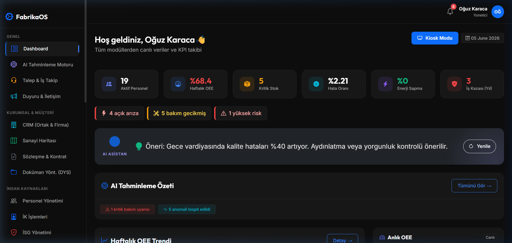
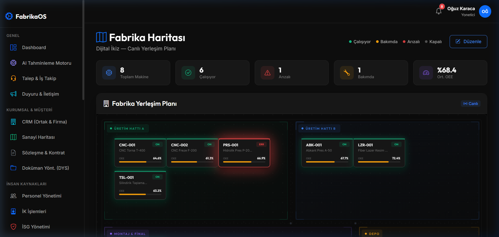
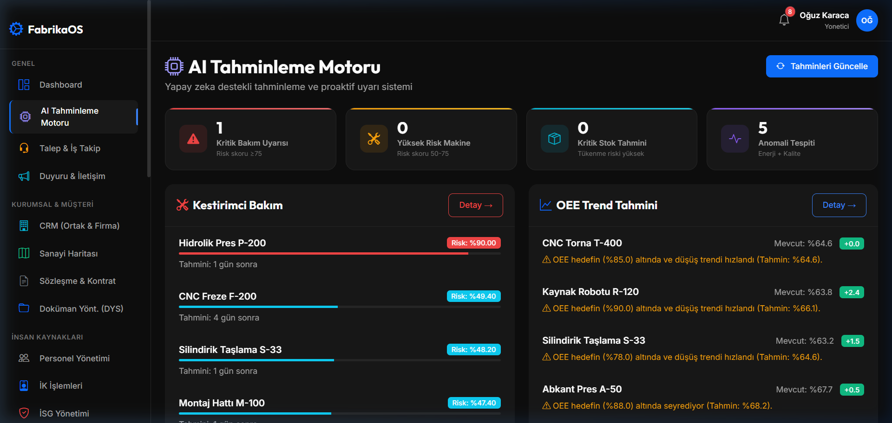
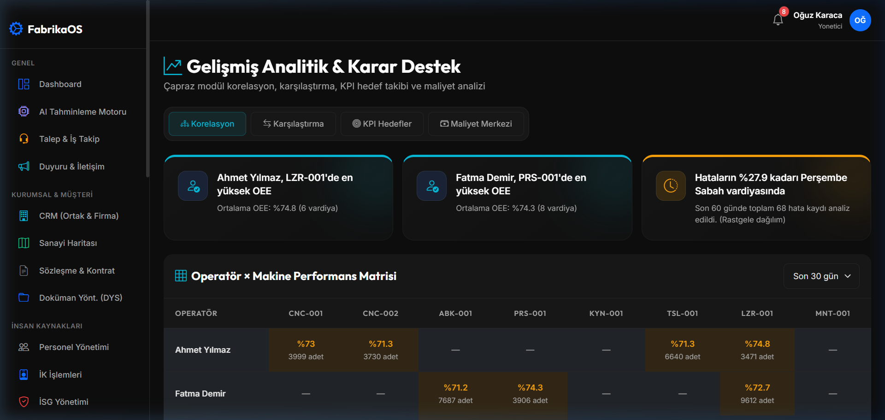
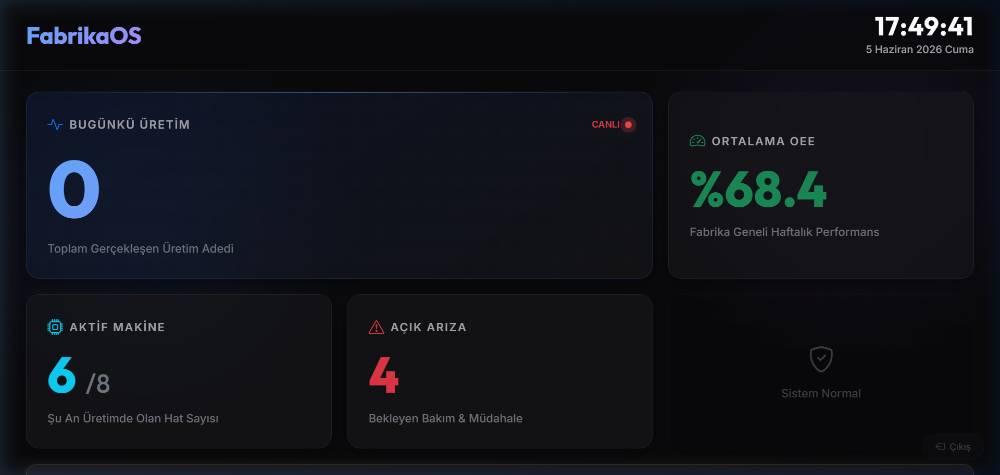
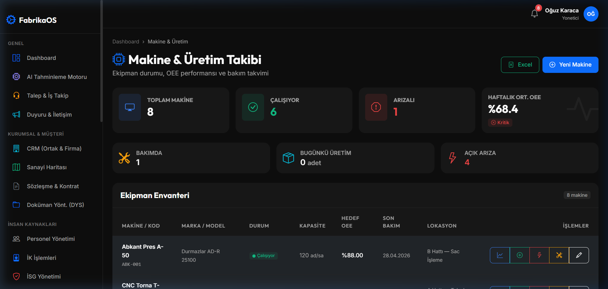
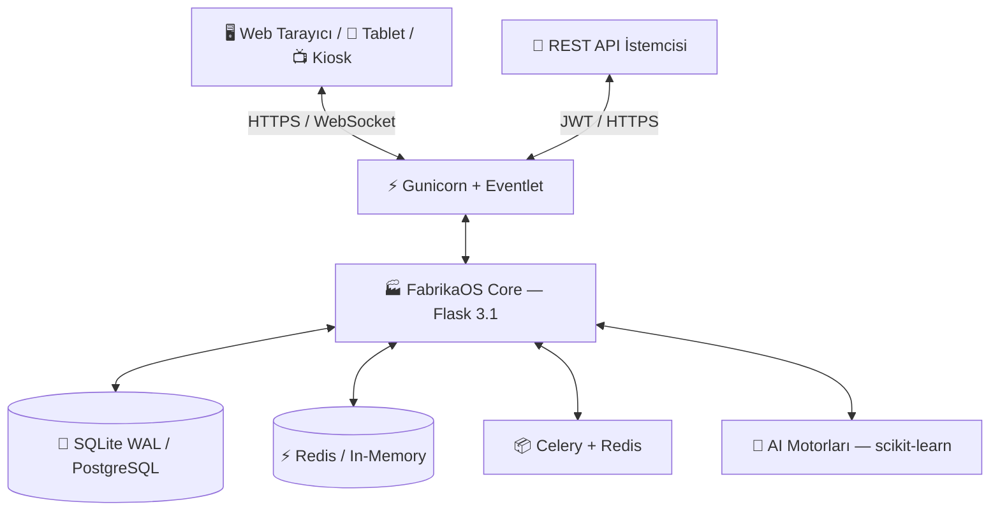
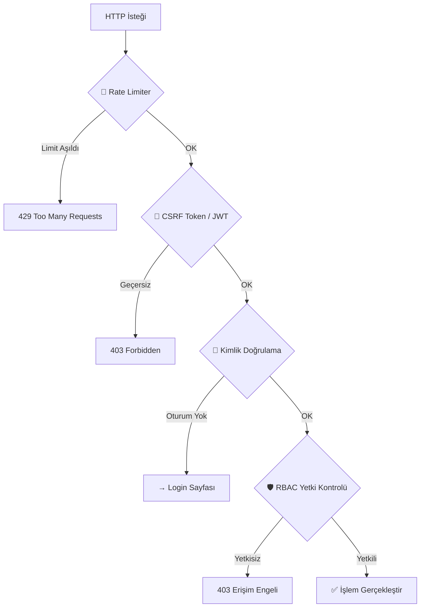
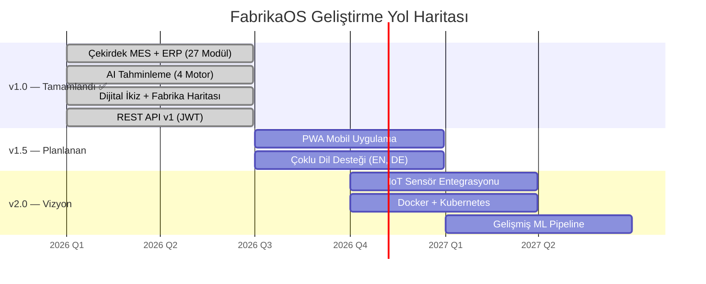

<div align="center">

  <br>
  
  

  <br><br>

  # FabrikaOS
  
  ### Fabrikanızın Dijital Beyni

  <br>

  *Metal ve ağır sanayi tesisleri için geliştirilmiş, yapay zeka destekli,*
  *kendi sunucunuzda çalışan açık kaynaklı MES + ERP platformu.*

  <br>

  [](https://www.python.org/)
  [](https://flask.palletsprojects.com/)
  [](https://scikit-learn.org/)
  [](https://socket.io/)
  [](#lisans)

  <br>

  [🚀 Hızlı Başlangıç](#-kurulum--5-dakikada-çalışır) · [📸 Ekran Görüntüleri](#-komuta-merkezinize-ilk-bakış) · [🤖 Yapay Zeka](#-yapay-zeka--arıza-olmadan-önlem-alın) · [📖 API Dokümantasyonu](API_DOKUMANTASYONU.md)

</div>

<br>

---

<br>

## 💡 Problem: Türk Sanayisinde Dijitalleşme Açığı

Türkiye'deki orta ve büyük ölçekli metal sanayi tesislerinin **%68'i** hâlâ üretim verilerini Excel tablolarında, bakım planlarını beyaz tahtada, stok takibini de kağıt üzerinde yönetiyor.

Bu ne demek?

| Sorun | Maliyet |
|:------|:--------|
| ⏱️ Plansız makine duruşları | Yılda ortalama **240+ saat** üretim kaybı |
| 📋 Elle raporlama | Haftalık **12+ adam-saat** israf |
| 🔧 Reaktif bakım | Arıza maliyetleri, planlı bakımdan **3-5 kat** fazla |
| 📦 Stok görünmezliği | Acil siparişlerden kaynaklanan **%15-25** maliyet artışı |
| 🛡️ İSG uyumsuzluğu | Yasal riskler ve cezai yaptırımlar |

> **FabrikaOS bu tabloyu tersine çevirir.** Tüm fabrika verileri tek bir karanlık komuta merkezinde toplanır; yapay zeka arızaları önceden tahmin eder, gerçek zamanlı OEE takibi verimliliği görünür kılar.

<br>

---

<br>

## 🎯 Nedir FabrikaOS?

**FabrikaOS (FDYS)**, metal ve ağır sanayi tesisleri için sıfırdan tasarlanmış bir **MES (Üretim Yönetim Sistemi)** ve **ERP (Kurumsal Kaynak Planlama)** hibrit platformudur.

Tek cümleyle: **Fabrikanızın her saniyesini ölçülebilir kılan dijital komuta merkezi.**

<div align="center">

### Temel Farklar

| | FabrikaOS | Geleneksel ERP | Rakip MES |
|:---|:---:|:---:|:---:|
| **Yapay Zeka Tahminleme** | ✅ 4 ayrı AI motoru | ❌ | ⚠️ Kısıtlı |
| **Gerçek Zamanlı (WebSocket)** | ✅ <1 sn gecikme | ❌ Dakikalarca | ⚠️ Polling |
| **İnteraktif Fabrika Haritası** | ✅ Dijital İkiz | ❌ | ❌ |
| **REST API (JWT)** | ✅ Tam CRUD | ⚠️ Ek Modül | ⚠️ Kısıtlı |
| **Türkçe Tam Destek** | ✅ | ⚠️ Çeviri | ❌ |
| **Self-hosted (Kendi Sunucu)** | ✅ Verileriniz sizde | ❌ SaaS kilidi | ⚠️ |
| **Kurulum Süresi** | ✅ **5 dakika** | ❌ Haftalarca | ❌ Günlerce |
| **Maliyet** | ✅ **Açık Kaynak** | ❌ 6-7 haneli lisans | ❌ Yıllık ücret |

</div>

<br>

---

<br>

## 📸 Komuta Merkezinize İlk Bakış

> *"Görmeden inanmam" diyorsanız, işte FabrikaOS'un gerçek ekran görüntüleri.*

<br>

### 🖥️ Yönetici Dashboard'u — Fabrikanın 360° Görünümü

Tüm KPI'lar, AI uyarıları ve modül özetleri tek bir ekranda. Aktif personel, haftalık OEE, kritik stok, hata oranları ve yapay zeka asistanı hep aynı bakışta.

<div align="center">
  
  <br><em>Yönetici Dashboard — Tek bakışta fabrikanın tamamı</em>
</div>

<br>

### 🏭 İnteraktif Fabrika Haritası — Dijital İkiz

Fabrika zemininin SVG tabanlı, sürükle-bırak destekli dijital kopyası. Makinelerin anlık durumunu (🟢 Çalışıyor, 🟡 Bakımda, 🔴 Arızalı) canlı olarak gösterir.

<div align="center">
  
  <br><em>Fabrika Haritası — Sahanın dijital ikizi</em>
</div>

<br>

### 🤖 AI Tahminleme Motoru — Arızadan Önce Haberdar Olun

scikit-learn tabanlı 4 ayrı yapay zeka motoru; kestirimci bakım risk skorları, OEE trend tahminleri ve stok tüketim öngörüleri sunar.

<div align="center">
  
  <br><em>Yapay Zeka Motoru — Arıza riskini gün bazında tahmin eder</em>
</div>

<br>

### 📊 Gelişmiş Analitik — Veriden Stratejiye

Operatör-makine performans matrisleri, korelasyon analizleri, vardiya bazlı hata trendleri ve maliyet dağılımları. Verilerinizi stratejik kararlara dönüştürür.

<div align="center">
  
  <br><em>Gelişmiş Analitik — Veriyi stratejiye çevirin</em>
</div>

<br>

### 📺 Kiosk Modu — Fabrika Zemini İçin Tasarlandı

Dev ekranlarda, dokunmatik terminallerde veya TV'lerde gösterilmek üzere optimize edilmiş tam ekran görünüm. Otomatik yenilenen canlı veriler ve kayan uyarı yazıları.

<div align="center">
  
  <br><em>Kiosk Modu — Sahada, tüm gözler üretim verisinde</em>
</div>

<br>

### ⚙️ Makine & Üretim Takibi

Tüm makine parkının tek ekranda listesi: marka, model, kapasite, OEE hedefi, son bakım tarihi ve konum bilgisi. Tek tuşla arıza bildirimi, üretim girişi veya bakım kaydı.

<div align="center">
  
  <br><em>Makine & Üretim Takibi — Parkınız kontrol altında</em>
</div>

<br>

---

<br>

## 🧩 27 Entegre Modül — Hammaddeden Sevkiyata

FabrikaOS, birbirine bağlı **27 modül** ile fabrikanın tamamını tek platformda yönetir. Her modül bağımsız çalışabilir, ancak asıl güç tüm modüllerin ortak veri havuzunu paylaşmasından gelir.

<br>

<div align="center">

```
   ╔═══════════════════════════════════════════════════════════════╗
   ║                    🏭 FabrikaOS Modülleri                    ║
   ╠═══════════════════════════════════════════════════════════════╣
   ║                                                               ║
   ║   ┌─────────────────┐  ┌─────────────────┐  ┌──────────────┐ ║
   ║   │  ÜRETİM & OEE   │  │   BAKIM & İŞ    │  │  KALİTE &    │ ║
   ║   │  ► Makine Takibi │  │   EMRİ          │  │  İSG         │ ║
   ║   │  ► Üretim Girişi │  │   ► Kestirimci  │  │  ► CAPA      │ ║
   ║   │  ► OEE Motoru    │  │   ► Arıza Kayıt │  │  ► Risk Dğl. │ ║
   ║   │  ► Kiosk Modu    │  │   ► Periyodik   │  │  ► Eğitim    │ ║
   ║   └─────────────────┘  └─────────────────┘  └──────────────┘ ║
   ║                                                               ║
   ║   ┌─────────────────┐  ┌─────────────────┐  ┌──────────────┐ ║
   ║   │  STOK & TEDARİK │  │   CRM & SÖZLEŞME│  │  İNSAN       │ ║
   ║   │  ► Malzeme       │  │   ► Firma Yön.  │  │  KAYNAKLARI  │ ║
   ║   │  ► Satın Alma    │  │   ► Ortak Yön.  │  │  ► Personel  │ ║
   ║   │  ► Tedarikçi     │  │   ► Kontrat     │  │  ► İzin/Mesai│ ║
   ║   │  ► Stok Tahmin   │  │   ► Talep Yön.  │  │  ► Zimmet    │ ║
   ║   └─────────────────┘  └─────────────────┘  └──────────────┘ ║
   ║                                                               ║
   ║   ┌─────────────────┐  ┌─────────────────┐  ┌──────────────┐ ║
   ║   │  AI & ANALİTİK  │  │   DİJİTAL İKİZ  │  │  KURUMSAL    │ ║
   ║   │  ► 4 AI Motoru   │  │   ► Fab. Harita  │  │  ► DYS       │ ║
   ║   │  ► Korelasyon    │  │   ► Site Harita  │  │  ► Duyuru    │ ║
   ║   │  ► KPI Takibi    │  │   ► Leaflet.js  │  │  ► Bildirim  │ ║
   ║   │  ► Raporlama     │  │   ► Sürükle-Bır │  │  ► REST API  │ ║
   ║   └─────────────────┘  └─────────────────┘  └──────────────┘ ║
   ║                                                               ║
   ╚═══════════════════════════════════════════════════════════════╝
```

</div>

<br>

### Modül Detayları

<details>
<summary><strong>🏭 Üretim & OEE Motoru</strong> — Fabrikanın kalp atışı</summary>

<br>

Üretim hattındaki her makineyi, her vardiyayı, her parçayı takip eder. **OEE (Overall Equipment Effectiveness)** formülüyle anlık verimlilik hesaplar:

```
OEE = Kullanılabilirlik × Performans × Kalite

Kullanılabilirlik = (Planlanan Üretim - Duruş Süresi) / Planlanan Üretim
Performans        = (Gerçekleşen Üretim × İdeal Çevrim) / Çalışma Süresi
Kalite            = (Toplam Üretim - Fire) / Toplam Üretim
```

- 📊 **Dinamik OEE Göstergesi** — Makine bazlı, vardiya bazlı, gün bazlı
- 📺 **Kiosk Modu** — Fabrika zemininde dev ekranlarda, otomatik yenilenen veriler
- ⚡ **Socket.IO** — <1 saniye gecikmeyle anlık veri akışı
- 📈 **Trend Grafikleri** — Chart.js ile etkileşimli verimlilik grafikleri

</details>

<details>
<summary><strong>🤖 Yapay Zeka & Tahminleme</strong> — 4 ayrı AI motoru</summary>

<br>

| AI Motoru | Algoritma | Ne Yapar? |
|:----------|:----------|:----------|
| **Kestirimci Bakım** | Regresyon + Trend | Makine arıza olasılığını **gün bazında** tahmin eder |
| **OEE Trend Analizi** | Zaman Serisi | Gelecek dönem **verimlilik düşüşlerini** önceden bildirir |
| **Stok Tahmin** | Tüketim Trendi | **Kritik stok seviyelerini** haftalarca önce uyarır |
| **Anomali Tespiti** | İstatistiksel Sapma | Üretim verilerindeki **anormallikleri** anında yakalar |

**Bonus — AI Operatör Önerisi:** İş emri oluşturulurken, operatörlerin geçmiş performansı (OEE, hata oranı) ve işin gereksinimleri (zorluk, beceri seti) analiz edilerek en uygun personel yapay zeka ile eşleştirilir.

</details>

<details>
<summary><strong>🗺️ Dijital İkiz & Fabrika Haritası</strong> — Sahanın canlı kopyası</summary>

<br>

- **SVG tabanlı** interaktif fabrika planı
- **Sürükle-bırak** ile makine konumlandırma — düzen düzenleme modu
- **Renk kodlu** durum göstergeleri: 🟢 Çalışıyor | 🟡 Bakımda | 🔴 Arızalı | ⚫ Kapalı
- **Hover** ile anlık makine detay kartları (OEE, son arıza, bakım tarihi)
- **Donanım hızlandırmalı** CSS transform animasyonları
- Ayrıca **Leaflet.js** tabanlı site haritası ve alan yönetimi modülü

</details>

<details>
<summary><strong>📋 İş Emri & Bakım Yönetimi</strong> — SLA takipli</summary>

<br>

- Öncelik seviyeleri: `Düşük → Orta → Yüksek → Kritik`
- **SLA (Service Level Agreement)** takibi ile süre aşımı bildirimleri
- Durum akışı: `Oluşturuldu → Atandı → Devam Ediyor → Tamamlandı`
- İş emri yorumları ve tam aktivite geçmişi
- AI destekli operatör atama önerisi
- Periyodik bakım takvimi ve hatırlatıcılar

</details>

<details>
<summary><strong>👥 CRM, Sözleşme & Talep Yönetimi</strong> — Paydaş ilişkileri</summary>

<br>

- **CRM:** Firma ve ortak yönetimi, yetkili kişiler, iletişim geçmişi, sektör bazlı filtreleme
- **Sözleşme:** Kira kontratı, sigorta poliçesi, otomatik yenileme, süre bitiş hatırlatma
- **Talep (Helpdesk):** Arıza, öneri, şikayet, bilgi talebi; SMS ve e-posta bildirim
- **Dış Panel:** Müşteri/tedarikçi/taşeron için kimlik doğrulamalı portal
- **Harita:** Leaflet.js ile konum bazlı görselleştirme

</details>

<details>
<summary><strong>👔 İnsan Kaynakları & İSG</strong> — Tam uyum</summary>

<br>

**İK Modülü:**
- Savunma/tutanak yönetimi, fazla mesai takibi
- Sertifika ve belge takip sistemi, maaş skalası yönetimi
- Zimmet kayıtları, giriş-çıkış evrak takibi, izin yönetimi

**İSG Modülü:**
- İş kazası ve ramak kala olay kayıtları
- Risk değerlendirme matrisi (Olasılık × Şiddet)
- İSG eğitim takibi, sağlık muayenesi yönetimi
- Güvenlik skoru hesaplama ve dashboard

</details>

<details>
<summary><strong>📦 Stok, Satın Alma & Enerji</strong> — Tedarik zinciri</summary>

<br>

- Malzeme giriş-çıkış hareketleri, kritik stok uyarıları
- AI destekli stok tüketim tahmini
- Satın alma talebi oluşturma ve çok adımlı onay akışı
- Teklif karşılaştırma, tedarikçi performans değerlendirme
- Makine bazlı enerji tüketim izleme (5 farklı enerji türü)
- Aylık/yıllık tüketim trend analizi ve maliyet raporlama

</details>

<details>
<summary><strong>📄 DYS, Duyuru & Raporlama</strong> — Kurumsal iletişim</summary>

<br>

- **Doküman Yönetim Sistemi (DYS):** Merkezi doküman deposu, sürüm kontrolü, erişim kontrolü
- **Duyuru Sistemi:** Şirket içi duyuru yayınlama, okunma takibi, hedef kitle belirleme
- **Raporlama:** PDF rapor (ReportLab), Excel dışa aktarma (openpyxl), Chart.js grafikleri
- **Bildirim Motoru:** Toast notification, e-posta ve SMS bildirim altyapısı

</details>

<br>

---

<br>

## 🤖 Yapay Zeka — Arıza Olmadan Önlem Alın

FabrikaOS'un AI motorları, geleneksel "kırıldığında tamir et" yaklaşımını ortadan kaldırır. **Veriye dayalı karar almayı** fabrikanın DNA'sına işler.

<br>

<div align="center">

```
                    ╭────────────────────────────────╮
                    │        VERİ TOPLAMA             │
                    │   Üretim · Sensör · Arıza       │
                    │   Bakım · Enerji · Kalite        │
                    ╰──────────────┬─────────────────╯
                                   │
                                   ▼
                    ╭────────────────────────────────╮
                    │      4 AI MOTORU ANALİZ        │
                    │                                │
                    │  🔧 Kestirimci Bakım           │
                    │  📈 OEE Trend Tahmin           │
                    │  📦 Stok Tüketim Tahmin        │
                    │  ⚠️  Anomali Tespiti            │
                    ╰──────────────┬─────────────────╯
                                   │
                                   ▼
                    ╭────────────────────────────────╮
                    │      PROAKTİF EYLEM            │
                    │                                │
                    │  → Bakım planla (14 gün önce)  │
                    │  → Stok siparişi tetikle       │
                    │  → Operatör ata (AI eşleşme)   │
                    │  → Yöneticiyi uyar              │
                    ╰────────────────────────────────╯
```

</div>

<br>

### Gerçek Dünya Etkisi

| Metrik | Hedeflenen İyileşme |
|:-------|:-------------------:|
| ⏱️ Plansız Duruş Süresinde Azalma | **%30+** |
| 📈 OEE Artışı | **%15-25** |
| 🔧 Bakım Maliyetinde Düşüş | **%20+** |
| 📋 Raporlama Süresinde Kısalma | **%80+** |
| 🛡️ İSG Uyum Oranı | **%100** |

<br>

---

<br>

## 🏛️ Teknik Mimari — Sağlam Temeller

FabrikaOS, kurumsal düzeyde ölçeklenebilir bir mimari üzerine inşa edilmiştir. Her katman bağımsız test edilebilir, bakım yapılabilir ve genişletilebilir.

<br>

### Mimari Genel Bakış



### Teknoloji Yığını

```
┌──────────────────────────────────────────────────────────────────┐
│                     🎨 FRONTEND KATMANI                          │
│  HTML5 + Jinja2 · CSS3 (Cinematic Industrial Dark Theme)         │
│  Bootstrap 5.3 · Chart.js · Socket.IO Client · SVG · Leaflet.js │
├──────────────────────────────────────────────────────────────────┤
│                     ⚙️ BACKEND KATMANI                            │
│  Python 3.12+ · Flask 3.1.1 (Application Factory + 27 Blueprint) │
│  SQLAlchemy 2.0 · Flask-Login · Flask-Bcrypt · Flask-JWT-Extended │
│  Flask-SocketIO + Eventlet · Flask-Limiter · Flask-Caching        │
│  Flask-Migrate + Alembic · Flask-WTF + CSRFProtect · Flask-CORS   │
├──────────────────────────────────────────────────────────────────┤
│                     💾 VERİTABANI KATMANI                         │
│  SQLite WAL Mode (Geliştirme) · PostgreSQL (Üretim)               │
│  35+ İlişkisel Tablo · Alembic Migrasyon · Foreign Key Bütünlüğü  │
├──────────────────────────────────────────────────────────────────┤
│                     🤖 YAPAY ZEKA KATMANI                         │
│  NumPy 2.2 · scikit-learn 1.6 · Kestirimci Bakım                 │
│  OEE Tahmin · Stok Tahmin · Anomali Tespiti · Operatör Eşleşme   │
├──────────────────────────────────────────────────────────────────┤
│                     📦 ASENKRON GÖREVLER                          │
│  Celery 5.4 · Redis · E-posta/SMS Bildirim · Rapor Oluşturma     │
└──────────────────────────────────────────────────────────────────┘
```

### Mimari Kararlar ve Neden

| Karar | Neden |
|:------|:------|
| **Application Factory Pattern** | Test, geliştirme, üretim ortamları aynı kodla çalışır; döngüsel import sorunları önlenir |
| **27 Blueprint Modülü** | Her modül bağımsız geliştirilebilir, test edilebilir ve devre dışı bırakılabilir |
| **SQLite WAL → PostgreSQL** | Geliştirmede sıfır bağımlılık, üretimde kurumsal performans |
| **Socket.IO + Eventlet** | WebSocket ile gerçek zamanlı veri akışı, polling'e gerek yok |
| **JWT + Session hibrit auth** | Web arayüzü için session, API için JWT — her kullanıma uygun |

<br>

---

<br>

## 🛡️ Güvenlik — OWASP Standartlarında

FabrikaOS, endüstriyel verilerin hassasiyetini bilerek **OWASP Top 10** standartlarına uygun güvenlik katmanlarıyla donatılmıştır.



| Katman | Teknoloji | Detay |
|:-------|:----------|:------|
| **Kimlik Doğrulama** | Flask-Login + Bcrypt + JWT | Güçlü session, parola hashleme, API token |
| **RBAC** | 7+ Rol | Yönetici, Operatör, Teknisyen, İK, İSG, Muhasebe, CRM, Satın Alma |
| **CSRF** | Flask-WTF CSRFProtect | Tüm formlarda otomatik token doğrulama |
| **Rate Limiting** | Flask-Limiter | Brute-force ve DDoS koruması |
| **Security Headers** | Custom Middleware | X-Frame, HSTS, CSP, XSS Protection |
| **Veri Bütünlüğü** | SQLite WAL + Foreign Key | Write-Ahead Logging, referans bütünlüğü |
| **Session Güvenliği** | HTTPOnly + SameSite=Lax | Cookie hijacking koruması |

<br>

---

<br>

## 🎨 Tasarım Felsefesi — "Cinematic Industrial"

FabrikaOS'un arayüzü rastgele değil, **bilinçli bir tasarım sistemi** üzerine kurulmuştur.

> Metal sanayisinin güçlü yapısını yansıtan, Bloomberg Terminal'in veri yoğunluğuyla lüks otomotiv arayüzlerinin estetiğini birleştiren **"Institutional Glassmorphism"** tasarım dili.

| Tasarım Öğesi | Yaklaşım |
|:--------------|:---------|
| **Renk Paleti** | Ultra-koyu yüzeyler (`#0f172a`, `#131317`) — göz yorgunluğunu minimize eder |
| **Vurgular** | Neon mavi (`#38bdf8`) ve zümrüt yeşil (`#56e5a9`) — kritik veriyi ışık kaynağı gibi vurgular |
| **Glassmorphism** | `backdrop-blur: 20px` + `%6 opacity` kenarlıklar — derinlik hissi |
| **Tipografi** | Plus Jakarta Sans (başlıklar) + Inter (veri) — komuta hissi |
| **Animasyonlar** | Skeleton loading, toast notifications, donanım hızlandırmalı CSS transforms |

<br>

---

<br>

## 🚀 Kurulum — 5 Dakikada Çalışır

FabrikaOS'u kendi makinenizde çalıştırmak için tek gereken Python 3.12+ ve 5 dakika.

### 1. Depoyu Klonlayın

```bash
git clone https://github.com/Scryne/FabrikaOS.git
cd FabrikaOS
```

### 2. Sanal Ortam & Bağımlılıklar

```bash
python -m venv .venv

# Windows:
.venv\Scripts\activate

# Linux / macOS:
# source .venv/bin/activate

pip install -r requirements.txt
```

### 3. Çevre Değişkenleri

Kök dizinde `.env` dosyası oluşturun:

```ini
FLASK_APP=run.py
FDYS_CONFIG=development
SECRET_KEY=super-gizli-kurumsal-anahtar-123
```

### 4. Veritabanı & Demo Verileri

```bash
flask db upgrade
python seed_data.py
```

### 5. Başlatın 🚀

```bash
python run.py
```

Tarayıcınızda **`http://localhost:5000`** adresini açın — FabrikaOS sizi karşılıyor.

<br>

### 🔑 Demo Hesapları

Sisteme giriş yaparak farklı rollerin farklı dashboard deneyimlerini keşfedin:

<details>
<summary><strong>📋 Tüm Demo Hesapları (İç + Dış Kullanıcılar)</strong></summary>

<br>

#### 🏢 İç Kullanıcılar (Fabrika Çalışanları)

| Ad Soyad | Kullanıcı Adı | Rol | Şifre |
|:---------|:-------------|:----|:------|
| Deniz Yazar | `admin` | 👑 Yönetici | `admin123` |
| Ahmet Yılmaz | `ahmet.yilmaz` | 🔧 Operatör | `demo123` |
| Fatma Demir | `fatma.demir` | 🔧 Operatör | `demo123` |
| Mehmet Kaya | `mehmet.kaya` | 🛠️ Teknisyen | `demo123` |
| Ayşe Özkan | `ayse.ozkan` | 🛠️ Teknisyen | `demo123` |
| Selin Aktaş | `selin.aktas` | 🛡️ İSG Uzmanı | `demo123` |
| Zeynep Arslan | `zeynep.arslan` | 👔 İK Uzmanı | `demo123` |
| Elif Yıldız | `elif.yildiz` | 💰 Muhasebe | `demo123` |
| Deniz Korkmaz | `deniz.korkmaz` | 📞 CRM Yetkilisi | `demo123` |
| Mustafa Şahin | `mustafa.sahin` | 📦 Satın Alma | `demo123` |

#### 🌐 Dış Kullanıcılar (Müşteri, Tedarikçi, Taşeron)

| Ad Soyad | Kullanıcı Adı | Firma (Tipi) | Şifre |
|:---------|:-------------|:-------------|:------|
| Merve Aydın | `merve.aydin` | Ford (Müşteri) | `musteri123` |
| Seda Yılmaz | `seda.yilmaz` | Renault (Müşteri) | `musteri123` |
| Ercan Koçak | `ercan.kocak` | Borusan (Tedarikçi) | `tedarikci123` |
| Hakan Demir | `hakan.demir` | Kardemir (Tedarikçi) | `tedarikci123` |
| Ali Vefa | `ali.vefa` | ABC Makina (Taşeron) | `taseron123` |

</details>

<br>

### 6. (Opsiyonel) Asenkron Görevler

```bash
# Redis sunucusu (ayrı terminal)
redis-server

# Celery worker (ayrı terminal)
celery -A celery_worker.celery worker --loglevel=info
```

<br>

---

<br>

## 🔌 REST API — Entegrasyona Hazır

FabrikaOS, üçüncü parti sistemlerle (ERP, SCADA, mobil uygulama) entegrasyon için **JWT tabanlı REST API** sunar.

### Hızlı Başlangıç

```bash
# 1. Token al
curl -X POST http://localhost:5000/api/v1/auth/login \
  -H "Content-Type: application/json" \
  -d '{"kullanici_adi": "admin", "sifre": "admin123"}'

# 2. Korumalı endpoint'e eriş
curl http://localhost:5000/api/v1/makineler \
  -H "Authorization: Bearer <access_token>"
```

### Endpoint Özeti

| Modül | Endpoint | Metotlar |
|:------|:---------|:---------|
| **Auth** | `/api/v1/auth/login`, `/refresh`, `/me` | POST, GET |
| **Ortaklar** | `/api/v1/ortaklar`, `/ortaklar/{id}` | GET, POST, PUT, DELETE |
| **Firmalar** | `/api/v1/firmalar`, `/firmalar/{id}` | GET, POST, PUT, DELETE |
| **Sözleşmeler** | `/api/v1/sozlesmeler`, `/sozlesmeler/{id}` | GET |
| **Talepler** | `/api/v1/talepler`, `/talepler/{id}` | GET, POST |
| **Personel** | `/api/v1/personel` | GET |
| **Makineler** | `/api/v1/makineler` | GET |
| **İş Emirleri** | `/api/v1/is-emirleri` | GET |
| **İstatistik** | `/api/v1/istatistik/ozet` | GET |

> 📖 Detaylı API dokümantasyonu için: [`API_DOKUMANTASYONU.md`](API_DOKUMANTASYONU.md)

<br>

---

<br>

## 📊 Demo Senaryosu

Demo ortamı, gerçekçi bir metal sanayi tesisini simüle eder:

> **Şirket:** AnadoluTech Metal Sanayi A.Ş.
> **Konum:** Kocaeli Organize Sanayi Bölgesi
> **Sektör:** Otomotiv Yan Sanayi — CNC İşleme & Metal Şekillendirme

**20 modülden yüklenen demo verileri:** 15 çalışan, 6 makine (CNC Torna, Freze, Pres, Kaynak vb.), 180 gün üretim verisi, 8 arıza kaydı, 12 malzeme, 25 İSG kaydı, 14 AI tahmini, 132 KPI hedefi ve daha fazlası. Tüm veriler gerçekçi metal sanayi senaryolarına dayanır.

<br>

---

<br>

## 🗺️ Yol Haritası



<br>

---

<br>

## 🤝 Katkıda Bulunma

FabrikaOS, yüksek kalite standartlarına göre sürdürülmektedir. Katkıda bulunmak isterseniz:

1. Kodun mevcut mimari yaklaşımlara (Blueprint MVC, Application Factory) uygun olduğundan emin olun
2. `pytest tests/ -v` ile tüm testlerin geçtiğini doğrulayın
3. Responsive tasarım kurallarına uyun
4. Kod Türkçe yazılır — modül isimleri, model sınıfları, route fonksiyonları ve DB sütunları Türkçe'dir

<br>

---

<br>

## 📜 Lisans

Bu proje [MIT Lisansı](LICENSE) altında lisanslanmıştır. Ticari ve bireysel kullanıma açıktır.

<br>

---

<br>

<div align="center">

  

  <br><br>

  **FabrikaOS — Üretim verileri artık bir yük değil, stratejik bir güç.**

  <br>

  *Geliştirici: [Scryne](https://github.com/Scryne)*

  <br>

  [](https://github.com/Scryne/FabrikaOS)

  <br>

  © 2026 FabrikaOS — Fabrika Dijital Yönetim Sistemi (FDYS)

</div>
