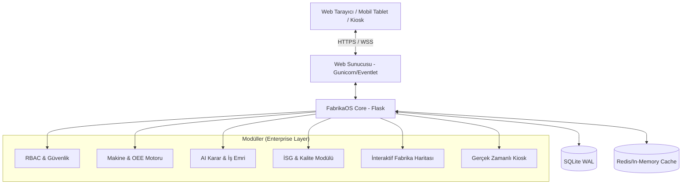

<div align="center">
  

  # FabrikaOS (FDYS)
  ### Kurumsal Kaynak ve Dijital Üretim Yönetim Sistemi
  
  *Endüstri 4.0 standartlarında, metal sektörü odaklı, yapay zeka destekli akıllı fabrika yönetim platformu.*

  [](https://www.python.org/)
  [](https://flask.palletsprojects.com/)
  [](https://sqlite.org/)
  [](https://getbootstrap.com/)
  [](#)
</div>

---

## 🌟 Vizyonumuz: Geleceğin Fabrikasını Bugünden İnşa Etmek

**FabrikaOS**, geleneksel üretim süreçlerini dijitalleştirerek görünürlük, verimlilik ve kontrol sağlayan **yeni nesil bir MES (Üretim Yönetim Sistemi) ve ERP (Kurumsal Kaynak Planlama)** hibrit çözümüdür. Özellikle **Metal Sanayisi** ve ağır sanayi gereksinimleri göz önünde bulundurularak optimize edilmiş olan bu sistem; yöneticilere 360 derece veri sunarken, operatörlere ve teknisyenlere sahada hız kazandırır.

B2B kurumsal vizyona uygun karanlık teması (Dark Mode) ve "Glassmorphism" odaklı estetik arayüzü ile kullanıcılarına yalnızca işlevsel değil, **görsel olarak da premium bir deneyim** yaşatır.

---

## 🚀 Öne Çıkan Kurumsal Özellikler

Sistem, modern endüstrinin ihtiyaçlarını karşılayacak şekilde ölçeklenebilir ve sağlam bir altyapı üzerine kurulmuştur.

### 🤖 Yapay Zeka & Tahminleme Motoru
- **Kestirimci Bakım:** Makine kullanım verilerine dayanarak gelecekteki olası arızaları tahmin eder.
- **AI Operatör Önerisi:** İş emrinin niteliğine (zorluk, gereken beceri seti) ve operatörlerin geçmiş performanslarına (OEE, hata oranı) göre en uygun personeli yapay zeka ile eşleştirir.
- **OEE Trend Analizi:** Son 30 günlük verileri analiz ederek gelecekteki verimlilik düşüşlerini proaktif olarak bildirir.

### 🏭 İnteraktif & Dijital İkiz Destekli Fabrika Haritası
- Sahadaki makinelerin durumunu (Çalışıyor, Durdu, Arızalı) canlı olarak SVG tabanlı **İnteraktif Fabrika Haritası** üzerinde gösterir.
- Tamamen sürükle-bırak (Drag & Drop) desteği ile makine yerleşimlerini dijital ortama taşır.
- CSS çakışmalarından arındırılmış, pürüzsüz donanım hızlandırmalı transform animasyonları barındırır.

### 📊 Gerçek Zamanlı Kiosk ve OEE Takibi
- Fabrika zemininde dev ekranlarda gösterilmek üzere tasarlanmış, **otomatik yenilenen Kiosk Modu**.
- Makinelerin Kullanılabilirlik (Availability), Performans (Performance) ve Kalite (Quality) verilerini hesaplayan **Dinamik OEE Motoru**.
- Socket.IO mimarisi sayesinde anlık veri akışı ve "Marquee" (Kayan yazı) şeklinde acil durum bildirimleri.

### 🛡️ Kurumsal Güvenlik ve RBAC (Rol Bazlı Erişim)
- Yönetici (Admin), Operatör ve Teknisyen için sıkı bir şekilde izole edilmiş yetkilendirme sistemi.
- OWASP standartlarında güvenlik: CSRF koruması, Rate Limiting (Flask-Limiter), güvenli oturum yönetimi ve SQL Injection önlemleri.
- Veri bütünlüğünü sağlamak adına SQLite WAL (Write-Ahead Logging) üretim modu aktivasyonu.

---

## 🏗️ Sistem Mimarisi



---

## 📦 Kurulum ve Çalıştırma

Geliştirme veya demo ortamınızı saniyeler içinde ayağa kaldırın:

### 1. Depoyu Klonlayın
```bash
git clone https://github.com/Scryne/FabrikaOS.git
cd FabrikaOS
```

### 2. Sanal Ortam ve Bağımlılıklar
```bash
python -m venv venv
# Windows:
venv\Scripts\activate
# Linux/Mac:
# source venv/bin/activate

pip install -r requirements.txt
```

### 3. Çevre Değişkenleri (.env)
Kök dizinde `.env` dosyasını oluşturun:
```ini
FLASK_APP=run.py
FDYS_CONFIG=development
SECRET_KEY=super-gizli-kurumsal-anahtar-123
```

### 4. Veritabanı ve Seed Verileri
Sistemin çalışması için gerekli tabloları ve demo (Metal sektörü) verilerini oluşturun:
```bash
flask db upgrade
python seed_data.py
```

### 5. Sunucuyu Başlatın
```bash
python run.py
```
Sistem `http://localhost:5000` adresinde aktif olacaktır.

---

### 🔑 Giriş Bilgileri (Demo Hesapları)

Sistemi çalıştırdıktan sonra, rol bazlı erişim mekanizmasını (RBAC) ve her role özel tasarlanmış dashboard panellerini test etmek için aşağıdaki ön tanımlı hesapları kullanabilirsiniz:

#### 1. Sistem Yöneticisi (Admin)
- **Kullanıcı Adı:** `admin`
- **Şifre:** `admin123`
- **Rolü:** Yönetici (Admin)
- **Erişebildiği Modüller:** Tüm modüller, Sistem Ayarları, Raporlar, AI Tahminleme, Gelişmiş Analitik.

#### 2. Operatörler (Üretim Girişi ve İzin Talepleri İçin)
- **Hesap 1 (Kıdemli Operatör)**
  - **Kullanıcı Adı:** `ahmet.yilmaz`
  - **Şifre:** `demo123`
  - **Erişebildiği Modüller:** Personel, Makine & Üretim, Stok, Kalite
- **Hesap 2 (Operatör)**
  - **Kullanıcı Adı:** `fatma.demir`
  - **Şifre:** `demo123`
  - **Erişebildiği Modüller:** Personel, Makine & Üretim, Stok

#### 3. Teknisyenler (Bakım ve Arıza Takibi İçin)
- **Hesap 1 (Kıdemli Teknisyen)**
  - **Kullanıcı Adı:** `mehmet.kaya`
  - **Şifre:** `demo123`
  - **Erişebildiği Modüller:** Makine & Üretim, İSG
- **Hesap 2 (Elektrik Teknisyeni)**
  - **Kullanıcı Adı:** `ayse.ozkan`
  - **Şifre:** `demo123`
  - **Erişebildiği Modüller:** Makine & Üretim, Enerji, İSG

---

## 🎨 UI/UX Tasarım Dili: "Metal" Teması
FabrikaOS, metal sanayisinin güçlü ve ağır yapısını yansıtan, profesyonel B2B sunumlarına tam uyumlu **premium dark mode** tasarım diline sahiptir.
- Derin lacivert ve siyah tonlarının karışımı (`#0f172a`, `#1e293b`).
- Mavi neon ve cam efektleri (Glassmorphism) ile desteklenmiş vurgular.
- Göz yormayan kontrast ayarları ve profesyonel tipografi.

---

## 🤝 Katkıda Bulunma & Geliştirme Standartları

Bu proje, yüksek kurumsal kalite standartlarına göre sürdürülmektedir. Pull Request (PR) oluşturmadan önce:
1. Kodun mevcut mimari yaklaşımlara (Blueprints, Flask MVC) uygun olduğundan emin olun.
2. Pytest üzerinden tüm entegrasyon testlerinin geçtiğini doğrulayın: `pytest tests/ -v`.
3. Yeni özellikler eklerken responsive tasarım kurallarına uyun.

---

<div align="center">
  <strong>© 2026 FabrikaOS - Dijital Dönüşümün Kalbi.</strong> <br>
  <em>Geliştirici: <a href="https://github.com/Scryne">Scryne</a></em>
</div>
