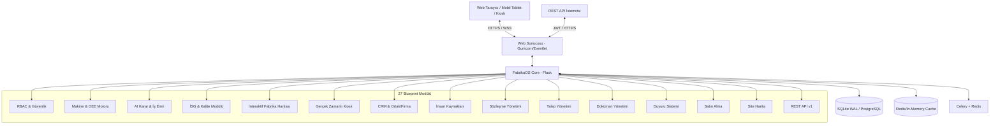
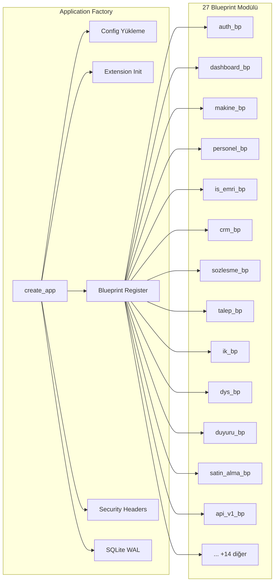
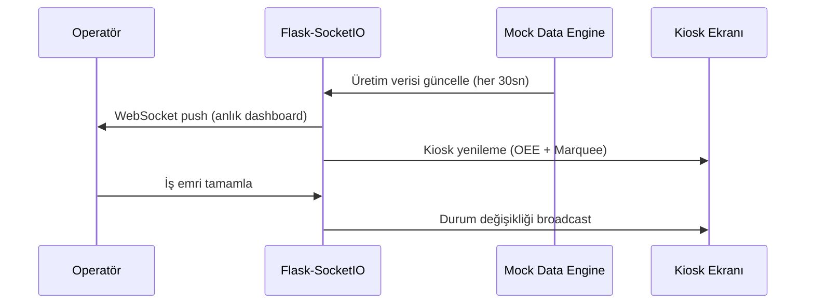
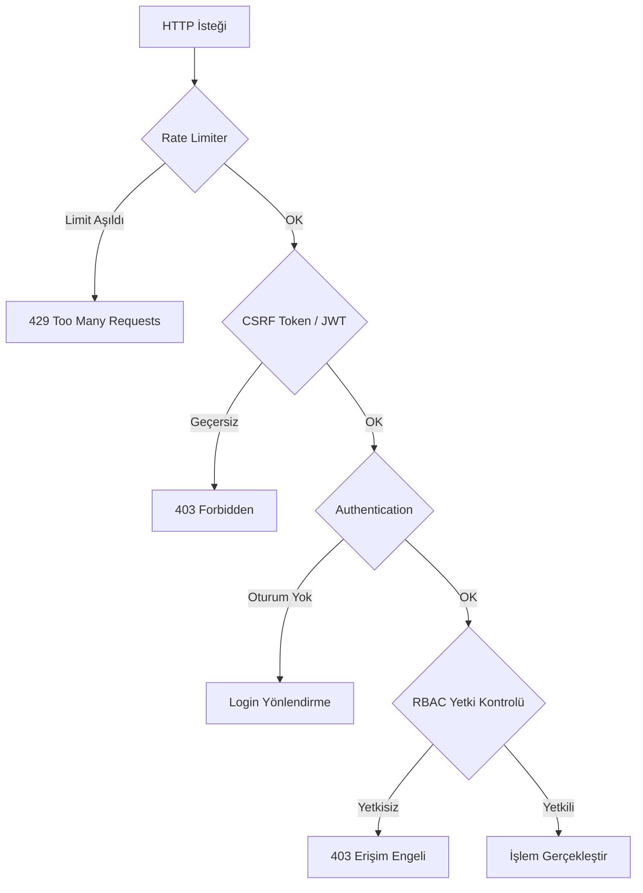

<div align="center">
  

  # FabrikaOS (FDYS)
  ### Kurumsal Kaynak ve Dijital Üretim Yönetim Sistemi
  
  *Endüstri 4.0 standartlarında, metal sektörü odaklı, yapay zeka destekli akıllı fabrika yönetim platformu.*

  [](https://www.python.org/)
  [](https://flask.palletsprojects.com/)
  [](https://sqlite.org/)
  [](https://getbootstrap.com/)
  [](#-rest-api-v1)
  [](#)
</div>

---

## 🌟 Vizyonumuz: Geleceğin Fabrikasını Bugünden İnşa Etmek

**FabrikaOS**, geleneksel üretim süreçlerini dijitalleştirerek görünürlük, verimlilik ve kontrol sağlayan **yeni nesil bir MES (Üretim Yönetim Sistemi) ve ERP (Kurumsal Kaynak Planlama)** hibrit çözümüdür. Özellikle **Metal Sanayisi** ve ağır sanayi gereksinimleri göz önünde bulundurularak optimize edilmiş olan bu sistem; yöneticilere 360 derece veri sunarken, operatörlere ve teknisyenlere sahada hız kazandırır.

B2B kurumsal vizyona uygun karanlık teması (Dark Mode) ve "Glassmorphism" odaklı estetik arayüzü ile kullanıcılarına yalnızca işlevsel değil, **görsel olarak da premium bir deneyim** yaşatır.

---

## 🚀 Öne Çıkan Kurumsal Özellikler

Sistem, modern endüstrinin ihtiyaçlarını karşılayacak şekilde ölçeklenebilir ve sağlam bir altyapı üzerine kurulmuştur.

### 🤖 Yapay Zeka & Tahminleme Motoru
- **Kestirimci Bakım:** Makine kullanım verilerine dayanarak gelecekteki olası arızaları tahmin eder.
- **AI Operatör Önerisi:** İş emrinin niteliğine (zorluk, gereken beceri seti) ve operatörlerin geçmiş performanslarına (OEE, hata oranı) göre en uygun personeli yapay zeka ile eşleştirir.
- **OEE Trend Analizi:** Son 30 günlük verileri analiz ederek gelecekteki verimlilik düşüşlerini proaktif olarak bildirir.
- **Stok Tahmin:** Tüketim trendlerini analiz ederek kritik stok seviyelerini önceden bildirir.

### 🏭 İnteraktif & Dijital İkiz Destekli Fabrika Haritası
- Sahadaki makinelerin durumunu (Çalışıyor, Durdu, Arızalı) canlı olarak SVG tabanlı **İnteraktif Fabrika Haritası** üzerinde gösterir.
- Tamamen sürükle-bırak (Drag & Drop) desteği ile makine yerleşimlerini dijital ortama taşır.
- CSS çakışmalarından arındırılmış, pürüzsüz donanım hızlandırmalı transform animasyonları barındırır.

### 📊 Gerçek Zamanlı Kiosk ve OEE Takibi
- Fabrika zemininde dev ekranlarda gösterilmek üzere tasarlanmış, **otomatik yenilenen Kiosk Modu**.
- Makinelerin Kullanılabilirlik (Availability), Performans (Performance) ve Kalite (Quality) verilerini hesaplayan **Dinamik OEE Motoru**.
- Socket.IO mimarisi sayesinde anlık veri akışı ve "Marquee" (Kayan yazı) şeklinde acil durum bildirimleri.

### 👥 CRM & Ortak/Firma Yönetimi
- **Ortak yönetimi:** Malik, kiracı, yetkili, vekil tiplerine göre ortak takibi.
- **Firma yönetimi:** Sektör bazlı firma kayıtları, yetkili kişiler, iletişim geçmişi.
- **Harita entegrasyonu:** Leaflet.js ile ortakların/firmaların konum bilgisi görselleştirmesi.

### 📋 Sözleşme Yönetimi
- Kira kontratı, sigorta poliçesi ve genel sözleşme türleri.
- **Otomatik yenileme** ve **süre bitiş hatırlatma** sistemi.
- Ödeme periyodu takibi (aylık/3-aylık/yıllık).
- Standart metin şablonları ile hızlı sözleşme oluşturma.

### 🎫 Talep Yönetimi (Helpdesk)
- Dahili ve harici kaynaklardan talep girişi (arıza, öneri, şikayet, bilgi talebi).
- **Dış panel** ile vatandaş/müşteri talep takibi (kimlik doğrulamalı).
- SMS ve e-posta bildirim desteği.
- Talep geçmişi, durum akışı ve memnuniyet puanı.

### 👔 İnsan Kaynakları (İK)
- Savunma/tutanak yönetimi, fazla mesai takibi.
- Sertifika ve belge takip sistemi.
- Maaş skalası yönetimi, zimmet kayıtları.
- Giriş-çıkış evrak takibi.

### 📄 Doküman Yönetim Sistemi (DYS)
- Merkezi doküman deposu, sürüm kontrolü.
- Kategori ve etiket bazlı organizasyon.
- Erişim kontrolü (departman/rol bazlı).

### 📢 Duyuru Sistemi
- Şirket içi duyuru yayınlama ve takibi.
- Öncelik ve hedef kitle belirleme.
- Okunma takibi ve raporlama.

### 🛒 Satın Alma Yönetimi
- Satın alma talebi oluşturma ve onay akışı.
- Sipariş yönetimi ve teklif karşılaştırma.
- Tedarikçi performans değerlendirme.

### 🗺️ Site Harita & Alan Yönetimi
- Leaflet.js tabanlı interaktif site haritası.
- Alan, bina, blok ve daire hiyerarşisi.
- Konum bazlı varlık izleme.

### 🛡️ Kurumsal Güvenlik ve RBAC (Rol Bazlı Erişim)
- Yönetici (Admin), Operatör ve Teknisyen için sıkı bir şekilde izole edilmiş yetkilendirme sistemi.
- OWASP standartlarında güvenlik: CSRF koruması, Rate Limiting (Flask-Limiter), güvenli oturum yönetimi ve SQL Injection önlemleri.
- Veri bütünlüğünü sağlamak adına SQLite WAL (Write-Ahead Logging) üretim modu aktivasyonu.

### 🔌 REST API v1 (JWT)
- **JWT tabanlı kimlik doğrulama** (access + refresh token).
- Tüm ana modüller için CRUD endpoint'leri.
- Sayfalama, filtreleme, sıralama, arama desteği.
- Rate limiting ile API güvenliği.
- Detaylı bilgi için: [`API_DOKUMANTASYONU.md`](API_DOKUMANTASYONU.md)

---

## 🏗️ Sistem Mimarisi



---

## 📦 Kurulum ve Çalıştırma

Geliştirme veya demo ortamınızı saniyeler içinde ayağa kaldırın:

### 1. Depoyu Klonlayın
```bash
git clone https://github.com/Scryne/FabrikaOS.git
cd FabrikaOS
```

### 2. Sanal Ortam ve Bağımlılıklar
```bash
python -m venv .venv
# Windows:
.venv\Scripts\activate
# Linux/Mac:
# source .venv/bin/activate

python -m pip install -r requirements.txt
```

### 3. Çevre Değişkenleri (.env)
Kök dizinde `.env` dosyasını oluşturun:
```ini
FLASK_APP=run.py
FDYS_CONFIG=development
SECRET_KEY=super-gizli-kurumsal-anahtar-123
```

### 4. Veritabanı ve Seed Verileri
Sistemin çalışması için gerekli tabloları ve demo (Metal sektörü) verilerini oluşturun:
```bash
flask db upgrade
python seed_data.py
```

### 5. Sunucuyu Başlatın
```bash
python run.py
```
Sistem `http://localhost:5000` adresinde aktif olacaktır.

### 6. (Opsiyonel) Redis & Celery
Asenkron görevler (bildirim, rapor oluşturma) için Redis ve Celery çalıştırın:
```bash
# Redis sunucusunu başlatın (ayrı terminal)
redis-server

# Celery worker'ı başlatın (ayrı terminal)
celery -A celery_worker.celery worker --loglevel=info
```

---

### 🔑 Giriş Bilgileri (Demo Hesapları)

Sistemi çalıştırdıktan sonra, rol bazlı erişim mekanizmasını (RBAC) ve her role özel tasarlanmış dashboard panellerini test etmek için aşağıdaki ön tanımlı hesapları kullanabilirsiniz:

#### 🏢 İç Kullanıcılar (Fabrika Çalışanları)

| Ad Soyad | Kullanıcı Adı | Rol | Şifre |
| :--- | :--- | :--- | :--- |
| Deniz Yazar | `admin` | Yönetici | `admin123` |
| Ahmet Yılmaz | `ahmet.yilmaz` | Operatör (Üretim) | `demo123` |
| Fatma Demir | `fatma.demir` | Operatör (Üretim) | `demo123` |
| Mehmet Kaya | `mehmet.kaya` | Teknisyen (Bakım) | `demo123` |
| Ayşe Özkan | `ayse.ozkan` | Teknisyen (Bakım) | `demo123` |
| Selin Aktaş | `selin.aktas` | İSG Uzmanı | `demo123` |
| Zeynep Arslan | `zeynep.arslan` | İK Uzmanı | `demo123` |
| Elif Yıldız | `elif.yildiz` | Muhasebe | `demo123` |
| Deniz Korkmaz | `deniz.korkmaz` | CRM Yetkilisi | `demo123` |
| Mustafa Şahin | `mustafa.sahin` | Satın Alma | `demo123` |

#### 🌐 Dış Kullanıcılar (Müşteri, Tedarikçi, Taşeron)

| Ad Soyad | Kullanıcı Adı | Firma (Tipi) | Şifre |
| :--- | :--- | :--- | :--- |
| Merve Aydın | `merve.aydin` | Ford (Müşteri) | `musteri123` |
| Seda Yılmaz | `seda.yilmaz` | Renault (Müşteri) | `musteri123` |
| Ercan Koçak | `ercan.kocak` | Borusan (Tedarikçi) | `tedarikci123` |
| Hakan Demir | `hakan.demir` | Kardemir (Tedarikçi) | `tedarikci123` |
| Ali Vefa | `ali.vefa` | ABC Makina (Taşeron) | `taseron123` |

#### 4. REST API Erişimi
Demo hesaplarının herhangi biriyle JWT token alabilirsiniz:
```bash
curl -X POST http://localhost:5000/api/v1/auth/login \
  -H "Content-Type: application/json" \
  -d '{"kullanici_adi": "admin", "sifre": "admin123"}'
```

---

## 🎨 UI/UX Tasarım Dili: "Cinematic Industrial" Teması
FabrikaOS, metal sanayisinin güçlü ve ağır yapısını yansıtan, profesyonel B2B sunumlarına tam uyumlu **premium dark mode** tasarım diline sahiptir.
- Derin lacivert ve siyah tonlarının karışımı (`#0f172a`, `#1e293b`).
- Mavi neon ve cam efektleri (Glassmorphism) ile desteklenmiş vurgular.
- Göz yormayan kontrast ayarları ve profesyonel tipografi.
- Loading skeleton'ları, toast notification animasyonları, print CSS desteği.

---

## 🏛️ Teknik Mimari

### Teknoloji Yığını (Tech Stack)

```
┌─────────────────────────────────────────────────────────────┐
│                      FRONTEND KATMANI                       │
├─────────────────────────────────────────────────────────────┤
│  HTML5 + Jinja2 Templating Engine                           │
│  CSS3 (Custom Dark Theme - "Cinematic Industrial")          │
│  Bootstrap 5.3 (Responsive Grid & Components)               │
│  Chart.js (Dinamik Grafikler & OEE Göstergeleri)            │
│  Vanilla JS + Socket.IO Client (Gerçek Zamanlı UI)          │
│  SVG (İnteraktif Fabrika Haritası & Dijital İkiz)           │
│  Leaflet.js (Site Harita & CRM Konum Görselleştirme)        │
├─────────────────────────────────────────────────────────────┤
│                      BACKEND KATMANI                        │
├─────────────────────────────────────────────────────────────┤
│  Python 3.12+                                               │
│  Flask 3.1.1 (Application Factory Pattern)                  │
│  Flask-SQLAlchemy 3.1.1 (ORM)                               │
│  Flask-SocketIO 5.5.1 + Eventlet (WebSocket)                │
│  Flask-Login (Session & RBAC)                               │
│  Flask-Bcrypt (Parola Hashleme)                             │
│  Flask-WTF + CSRFProtect (Form Güvenliği)                   │
│  Flask-Limiter (Brute-Force Koruması)                       │
│  Flask-Caching (Performans Optimizasyonu)                   │
│  Flask-Migrate / Alembic (DB Migrasyon)                     │
│  Flask-JWT-Extended (REST API Kimlik Doğrulama)             │
│  Flask-CORS (Cross-Origin Resource Sharing)                 │
│  Celery + Redis (Asenkron Görevler)                         │
├─────────────────────────────────────────────────────────────┤
│                    VERİTABANI KATMANI                        │
├─────────────────────────────────────────────────────────────┤
│  SQLite (WAL Mode) — Geliştirme & Demo                      │
│  PostgreSQL — Üretim Ortamı Desteği (psycopg2)              │
│  35+ İlişkisel Tablo, Foreign Key Bütünlüğü                │
├─────────────────────────────────────────────────────────────┤
│                   YAPAY ZEKA KATMANI                         │
├─────────────────────────────────────────────────────────────┤
│  NumPy 2.2.5 (Veri İşleme)                                 │
│  scikit-learn 1.6.1 (ML Modelleri)                          │
│  Kestirimci Bakım, Anomali Tespiti, OEE Tahmin, Stok Tahmin│
└─────────────────────────────────────────────────────────────┘
```

### Mimari Desen: Application Factory + Blueprint MVC



**Neden Application Factory?**
- ✅ Test, geliştirme ve üretim ortamları aynı kod tabanıyla çalışır
- ✅ Döngüsel import sorunları önlenir
- ✅ Her ortam için farklı yapılandırma (`DevelopmentConfig`, `ProductionConfig`, `TestingConfig`)

### Veritabanı Şeması (ER Özeti)

Sistem **35+ ilişkisel tablodan** oluşmaktadır:

| Modül | Tablolar | Açıklama |
|-------|----------|----------|
| **Kullanıcı & Personel** | `Kullanici`, `DenetimIzi`, `Calisan`, `VardiyaPlani`, `IzinTalebi` | RBAC, vardiya yönetimi |
| **İnsan Kaynakları** | `SavunmaTutanak`, `FazlaMesai`, `SertifikaTakip`, `MaasSkalasi`, `ZimmetKaydi`, `GirisCikisEvrak` | İK süreçleri |
| **Makine & Üretim** | `Makine`, `UretimVerisi`, `ArizaKaydi`, `BakimKaydi`, `DurusKaydi` | OEE hesaplamalı üretim takibi |
| **Stok** | `Malzeme`, `StokHareketi`, `Tedarikci` | Tedarik zinciri yönetimi |
| **Kalite** | `HataKaydi`, `DuzelticiFaaliyet` | CAPA düzeltici eylemler |
| **Enerji** | `EnerjiTuketimi` | Makine bazlı tüketim izleme |
| **İSG** | `IsKazasi`, `RiskDegerlendirme`, `IsgEgitimi`, `SaglikMuayenesi`, `IsgDokumani` | İş güvenliği & eğitim |
| **İş Emri** | `IsEmri`, `IsEmriYorum` | SLA takipli iş yönetimi |
| **CRM** | `Ortak`, `Firma`, `FirmaYetkilisi`, `CrmIletisimGecmisi` | Paydaş ilişki yönetimi |
| **Sözleşme** | `Sozlesme`, `KiraKontrat`, `SigortaPolice`, `StandartMetin` | Sözleşme lifecycle yönetimi |
| **Talep** | `Talep`, `TalepGecmisi` | Helpdesk & talep akışı |
| **DYS** | `Dokuman` | Doküman yönetimi |
| **Duyuru** | `Duyuru`, `DuyuruOkunma` | Şirket içi iletişim |
| **Satın Alma** | `SatinAlmaTalebi`, `SatinAlmaSiparis`, `TeklifKarsilastirma` | Tedarik yönetimi |
| **Dış Kullanıcı** | `DisKullanici`, `Borc`, `Tahsilat` | Dış paydaş erişimi |
| **Kurumsal** | `KurumsalAyarlar`, `EpostaAyarlari`, `DosyaEki` | Sistem ayarları |
| **AI & Analitik** | `KpiHedef`, `TahminKaydi` | 11 KPI × 12 ay, 14 tahmin |

### Gerçek Zamanlı İletişim Mimarisi



---

## ⚙️ Modül Detayları

### 🤖 Yapay Zeka & Tahminleme Motoru

FabrikaOS, **4 ayrı AI motoru** barındırır:

| AI Modülü | Algoritma | İşlev |
|-----------|-----------|-------|
| **Kestirimci Bakım** | Regresyon + Trend Analizi | Makine arıza olasılığını önceden tahmin eder |
| **Anomali Tespiti** | İstatistiksel Sapma Analizi | Üretim verilerindeki anormallikleri yakalar |
| **OEE Tahmin** | Zaman Serisi Analizi | Gelecek dönem verimlilik öngörüsü sunar |
| **Stok Tahmin** | Tüketim Trendi Modeli | Kritik stok seviyelerini önceden bildirir |

**AI Operatör Önerisi:** İş emri oluşturulurken, operatörlerin geçmiş performansı (OEE, hata oranı) ve iş emrinin gereksinimleri (zorluk, beceri seti) analiz edilerek en uygun personel **yapay zeka ile eşleştirilir**.

### 🏭 İnteraktif Fabrika Haritası (Dijital İkiz)

- **SVG tabanlı** gerçek zamanlı fabrika görselleştirmesi
- **Sürükle-Bırak** ile makine konumlandırma
- Makine durumları renk kodlu: 🟢 Çalışıyor | 🟡 Durdu | 🔴 Arızalı
- Donanım hızlandırmalı CSS transform animasyonları
- Hover ile anlık makine detay kartları

### 📊 OEE Motoru & Kiosk Modu

**OEE (Overall Equipment Effectiveness)** hesaplama formülü:

```
OEE = Kullanılabilirlik × Performans × Kalite

Kullanılabilirlik = (Planlanan Üretim - Duruş Süresi) / Planlanan Üretim
Performans        = (Gerçekleşen Üretim × İdeal Çevrim) / Çalışma Süresi  
Kalite             = (Toplam Üretim - Fire) / Toplam Üretim
```

**Kiosk Modu Özellikleri:**
- Fabrika zemininde dev ekranlar için optimize edilmiş tam ekran görünüm
- Otomatik yenilenen (auto-refresh) canlı veriler
- Kayan yazı (Marquee) ile acil durum bildirimleri
- Socket.IO ile anlık veri akışı

### 📋 İş Emri Yönetimi

- Öncelik seviyeleri: Düşük → Orta → Yüksek → Kritik
- **SLA (Service Level Agreement)** takibi ile süre aşımı bildirimleri
- İş emri yorumları ve aktivite geçmişi
- AI destekli operatör atama önerisi
- Durum akışı: `Oluşturuldu → Atandı → Devam Ediyor → Tamamlandı`

### 📈 Gelişmiş Analitik & Raporlama

| Analitik Servisi | Açıklama |
|------------------|----------|
| **KPI Servisi** | 11 temel KPI metriğini 12 aylık hedeflerle karşılaştırır |
| **Korelasyon Analizi** | Üretim parametreleri arasındaki ilişkileri keşfeder |
| **Karşılaştırma** | Makine-makine, vardiya-vardiya performans kıyaslaması |
| **Maliyet Analizi** | Üretim maliyeti, bakım maliyeti, enerji maliyeti dağılımı |

**Rapor Çıktıları:**
- 📄 PDF rapor oluşturma (ReportLab)
- 📊 Excel rapor dışa aktarma (openpyxl)
- 📈 Etkileşimli Chart.js grafikleri

### 🛡️ İş Sağlığı ve Güvenliği (İSG)

- İş kazası ve ramak kala olay kayıtları
- Risk değerlendirme matrisi (Olasılık × Şiddet)
- İSG eğitim takibi ve sertifika yönetimi
- Sağlık muayenesi ve İSG doküman yönetimi
- Risk puanlama servisi ile otomatik önceliklendirme

### 🔌 Enerji Yönetimi

- Makine bazlı enerji tüketim izleme (kWh)
- 5 farklı enerji türü takibi (Elektrik, Doğalgaz, Basınçlı Hava vb.)
- Aylık/yıllık tüketim trend analizi
- Enerji maliyeti raporlama

### 📦 Stok & Tedarik Zinciri

- Malzeme giriş-çıkış hareketleri
- Kritik stok seviyesi uyarıları
- 7 tedarikçi, 12 malzeme, 18 hareket kaydı (demo)
- AI destekli stok tüketim tahmini

---

## 🔌 REST API v1

FabrikaOS, üçüncü parti sistemlerle entegrasyon için **JWT tabanlı REST API** sunar.

### Hızlı Başlangıç

```bash
# 1. Token al
curl -X POST http://localhost:5000/api/v1/auth/login \
  -H "Content-Type: application/json" \
  -d '{"kullanici_adi": "admin", "sifre": "admin123"}'

# 2. Korumalı endpoint'e eriş
curl http://localhost:5000/api/v1/ortaklar \
  -H "Authorization: Bearer <access_token>"
```

### Endpoint Özeti

| Modül | Endpoint | Metotlar |
|-------|----------|----------|
| **Auth** | `/api/v1/auth/login` | POST |
| **Auth** | `/api/v1/auth/refresh` | POST |
| **Auth** | `/api/v1/auth/me` | GET |
| **Ortaklar** | `/api/v1/ortaklar` | GET, POST |
| **Ortaklar** | `/api/v1/ortaklar/{id}` | GET, PUT, DELETE |
| **Firmalar** | `/api/v1/firmalar` | GET, POST |
| **Firmalar** | `/api/v1/firmalar/{id}` | GET, PUT, DELETE |
| **Sözleşmeler** | `/api/v1/sozlesmeler` | GET |
| **Sözleşmeler** | `/api/v1/sozlesmeler/{id}` | GET |
| **Talepler** | `/api/v1/talepler` | GET, POST |
| **Talepler** | `/api/v1/talepler/{id}` | GET |
| **Personel** | `/api/v1/personel` | GET |
| **Makineler** | `/api/v1/makineler` | GET |
| **Malzemeler** | `/api/v1/malzemeler` | GET |
| **İş Emirleri** | `/api/v1/is-emirleri` | GET |
| **Duyurular** | `/api/v1/duyurular` | GET |
| **İstatistik** | `/api/v1/istatistik/ozet` | GET |

> 📖 Detaylı API dokümantasyonu için: [`API_DOKUMANTASYONU.md`](API_DOKUMANTASYONU.md)

---

## 🔒 Güvenlik Mimarisi

FabrikaOS, **OWASP Top 10** standartlarına uygun güvenlik katmanlarıyla donatılmıştır:



| Güvenlik Katmanı | Teknoloji | Açıklama |
|-------------------|-----------|----------|
| **Kimlik Doğrulama** | Flask-Login + Bcrypt + JWT | Güçlü session, parola hashleme, API token |
| **RBAC** | 3 Rol (Admin, Operatör, Teknisyen) | İzole yetkilendirme |
| **CSRF** | Flask-WTF CSRFProtect | Tüm formlarda token doğrulama |
| **Rate Limiting** | Flask-Limiter | Brute-force saldırı önleme |
| **Security Headers** | Custom Middleware | X-Frame, HSTS, CSP, XSS Protection |
| **Veri Bütünlüğü** | SQLite WAL + FK | Write-Ahead Logging, Foreign Key |
| **Session** | HTTPOnly + SameSite=Lax | Cookie güvenliği |
| **API** | JWT Bearer Token | REST API için token tabanlı kimlik doğrulama |

---

## 🧩 Proje Yapısı

```
FabrikaOS/
├── app/
│   ├── __init__.py              # Application Factory
│   ├── extensions.py            # Flask uzantı tanımları
│   ├── models/                  # 23 veri modeli dosyası (SQLAlchemy ORM)
│   │   ├── kullanici.py         #   Kullanıcı & RBAC & DenetimIzi
│   │   ├── makine.py            #   Makine, Üretim, Arıza, Bakım, Duruş
│   │   ├── personel.py          #   Çalışan, Vardiya, İzin
│   │   ├── is_emri.py           #   İş emri & yorumlar
│   │   ├── kalite.py            #   Hata & CAPA
│   │   ├── stok.py              #   Malzeme, Hareket, Tedarikçi
│   │   ├── enerji.py            #   Enerji tüketimi
│   │   ├── isg.py               #   İş kazası, Risk, Eğitim, Sağlık, Doküman
│   │   ├── analitik.py          #   KPI hedefleri & tahminler
│   │   ├── crm.py               #   Ortak, Firma, Yetkili, İletişim Geçmişi
│   │   ├── sozlesme.py          #   Sözleşme, Kira, Sigorta, Standart Metin
│   │   ├── talep.py             #   Talep & Geçmiş
│   │   ├── ik.py                #   Savunma, Mesai, Sertifika, Maaş, Zimmet
│   │   ├── dys.py               #   Doküman yönetimi
│   │   ├── duyuru.py            #   Duyuru & Okunma
│   │   ├── satin_alma.py        #   Satın Alma Talebi, Sipariş, Teklif
│   │   ├── dis_kullanici.py     #   Dış Kullanıcı, Borç, Tahsilat
│   │   ├── dosya.py             #   Dosya ekleri
│   │   ├── eposta.py            #   E-posta ayarları
│   │   ├── bildirim.py          #   Bildirim sistemi
│   │   ├── tahmin.py            #   AI tahmin kayıtları
│   │   └── kurumsal.py          #   Kurumsal ayarlar
│   ├── routes/                  # 27 Blueprint (URL & Controller)
│   │   ├── auth.py              #   Giriş/Çıkış
│   │   ├── dashboard.py         #   Rol bazlı dashboard'lar
│   │   ├── makine.py            #   Makine CRUD & OEE
│   │   ├── personel.py          #   Personel yönetimi
│   │   ├── is_emri.py           #   İş emri CRUD
│   │   ├── fabrika_harita.py    #   İnteraktif harita
│   │   ├── tahmin.py            #   AI tahminleme arayüzü
│   │   ├── analitik.py          #   Gelişmiş analitik
│   │   ├── rapor.py             #   PDF/Excel raporlama
│   │   ├── admin.py             #   Yönetici paneli
│   │   ├── crm.py               #   CRM & Ortak/Firma yönetimi
│   │   ├── sozlesme.py          #   Sözleşme yönetimi
│   │   ├── talep.py             #   Talep yönetimi
│   │   ├── ik.py                #   İnsan Kaynakları
│   │   ├── dys.py               #   Doküman Yönetim Sistemi
│   │   ├── duyuru.py            #   Duyuru sistemi
│   │   ├── satin_alma.py        #   Satın alma yönetimi
│   │   ├── dis_panel.py         #   Dış kullanıcı paneli
│   │   ├── site_harita.py       #   Site harita & alan yönetimi
│   │   ├── api_v1.py            #   REST API v1 (JWT)
│   │   └── ...                  #   +7 diğer modül
│   ├── services/                # İş mantığı servisleri
│   │   ├── ai/                  #   4 AI motoru
│   │   │   ├── kestirimci_bakim.py
│   │   │   ├── anomali_tespit.py
│   │   │   ├── oee_tahmin.py
│   │   │   └── stok_tahmin.py
│   │   ├── analitik/            #   4 analitik servisi
│   │   │   ├── kpi_servisi.py
│   │   │   ├── korelasyon.py
│   │   │   ├── karsilastirma.py
│   │   │   └── maliyet_servisi.py
│   │   ├── tahmin_motoru.py     #   Ana tahmin orkestratörü
│   │   ├── otomasyon_motoru.py  #   Otomasyon kuralları
│   │   ├── bildirim_motoru.py   #   Bildirim sistemi
│   │   ├── oee_hesaplama.py     #   OEE formül motoru
│   │   └── mock_engine.py       #   Canlı demo veri üreteci
│   ├── templates/               # 27+ template dizini (Jinja2)
│   ├── static/                  # CSS, JS, görseller
│   └── forms/                   # WTForms form sınıfları
├── seeds/                       # 20 modül demo verisi
├── migrations/                  # Alembic DB migration'ları
├── tests/                       # Pytest test suite
├── deployment/                  # Üretim deployment dosyaları
├── config.py                    # 3 ortam yapılandırması
├── run.py                       # Uygulama giriş noktası
├── seed_data.py                 # Demo veri orkestratörü (20 modül)
├── celery_worker.py             # Celery asenkron görev worker'ı
├── requirements.txt             # 30+ Python bağımlılığı
├── KURULUM_VE_KULLANIM_REHBERI.md  # Kullanım rehberi
├── API_DOKUMANTASYONU.md        # REST API dokümantasyonu
├── OWASP_Guvenlik_Kontrol_Listesi.md  # Güvenlik kontrol listesi
└── DESIGN.md                    # Tasarım dokümanı
```

---

## 📊 Demo Senaryosu

Demo ortamı, gerçekçi bir **metal sanayi tesisi** senaryosunu simüle eder:

> **Şirket:** AnadoluTech Metal Sanayi A.Ş.  
> **Konum:** Kocaeli Organize Sanayi Bölgesi  
> **Sektör:** Otomotiv Yan Sanayi — CNC İşleme & Metal Şekillendirme

### Yüklenen Demo Verileri (20 Modül)

| Veri Seti | Miktar | Detay |
|-----------|--------|-------|
| Kullanıcılar | 5 hesap | 1 Admin + 2 Operatör + 2 Teknisyen |
| Çalışanlar | 15 kişi | Farklı departman ve beceri setleri |
| Makine Parkı | 6 makine | CNC Torna, Freze, Pres, Kaynak vb. |
| Üretim Verileri | 180 gün | 3 vardiya, OEE hesaplamalı |
| Arıza Kayıtları | 8 kayıt | Açık + çözülmüş |
| Bakım Kayıtları | 9 kayıt | Periyodik + korektif |
| Stok | 12 malzeme | 7 tedarikçi, 18 hareket |
| Kalite | 8 hata | 5 CAPA düzeltici faaliyet |
| Enerji | 5 ay | 5 tür, makine bazlı |
| İSG | 25 kayıt | 5 kaza, 8 risk, 12 eğitim |
| İş Emirleri | 10 emir | 5 yorum, SLA takipli |
| KPI Hedefleri | 132 kayıt | 11 KPI × 12 ay |
| AI Tahminleri | 14 tahmin | Bakım, OEE, stok, anomali |
| Satın Alma | 26 kayıt | 17 talep, 9 sipariş |
| CRM | Ortaklar & Firmalar | Yetkililer, iletişim geçmişi |
| Sözleşmeler | Kira & Sigorta | Kontrat, poliçe, standart metin |
| Talepler | Arıza & Öneri | Durum akışı, geçmiş kaydı |
| DYS | Dokümanlar | Kategorize edilmiş dosyalar |
| Duyurular | Şirket içi | Farklı öncelik ve türlerde |
| Site Harita | Alan/Bina/Blok | Hiyerarşik yapı |

---

## 📈 Rekabet Avantajları

| Özellik | FabrikaOS | Geleneksel ERP | Rakip MES |
|---------|:---------:|:--------------:|:---------:|
| Yapay Zeka Tahminleme | ✅ | ❌ | ⚠️ Kısıtlı |
| Gerçek Zamanlı (WebSocket) | ✅ | ❌ | ⚠️ Polling |
| İnteraktif Fabrika Haritası | ✅ | ❌ | ❌ |
| REST API (JWT) | ✅ | ⚠️ Ek Modül | ⚠️ Kısıtlı |
| CRM & Sözleşme Yönetimi | ✅ | ⚠️ Ayrı Sistem | ❌ |
| Talep Yönetimi (Helpdesk) | ✅ | ❌ | ❌ |
| Kiosk Modu | ✅ | ❌ | ⚠️ Ek Modül |
| Rol Bazlı Dashboard | ✅ 3 Rol | ⚠️ Tek Panel | ⚠️ 2 Rol |
| Metal Sektör Optimizasyonu | ✅ | ❌ Genel | ❌ Genel |
| Türkçe Tam Destek | ✅ | ⚠️ Kısıtlı | ❌ |
| Kurulum Kolaylığı | ✅ 5 dk | ❌ Haftalarca | ❌ Günlerce |
| Açık Kaynak Esnekliği | ✅ | ❌ Kapalı | ❌ Lisanslı |

---

## 🔮 Gelecek Yol Haritası (Roadmap)

```mermaid
gantt
    title FabrikaOS Geliştirme Yol Haritası
    dateFormat YYYY-Q
    axisFormat %Y-Q%q

    section v1.0 (Mevcut)
    Çekirdek MES + ERP Modülleri        :done, 2026-Q1, 2026-Q2
    AI Tahminleme Motoru                :done, 2026-Q1, 2026-Q2
    İnteraktif Fabrika Haritası         :done, 2026-Q1, 2026-Q2
    CRM & Sözleşme & Talep Modülleri    :done, 2026-Q1, 2026-Q2
    REST API v1 (JWT)                   :done, 2026-Q1, 2026-Q2

    section v1.5 (Planlanan)
    Mobil Uygulama (PWA)                :2026-Q3, 2026-Q4
    Çoklu Dil Desteği (i18n)            :2026-Q3, 2026-Q4

    section v2.0 (Vizyon)
    IoT Sensör Entegrasyonu             :2026-Q4, 2027-Q1
    Docker + Kubernetes Deployment      :2026-Q4, 2027-Q1
    Gelişmiş ML Pipeline                :2027-Q1, 2027-Q2
```

### Planlanan Geliştirmeler

- 📱 **PWA Mobil:** Saha operatörleri için Progressive Web App
- 🌐 **i18n:** Çoklu dil desteği (İngilizce, Almanca)
- 🔗 **IoT Gateway:** PLC ve sensörlerden doğrudan veri toplama
- 🐳 **Konteynerizasyon:** Docker Compose ile tek komutla deployment
- 🧠 **Gelişmiş ML:** Derin öğrenme tabanlı tahminleme pipeline

---

## 🤝 Katkıda Bulunma & Geliştirme Standartları

Bu proje, yüksek kurumsal kalite standartlarına göre sürdürülmektedir. Pull Request (PR) oluşturmadan önce:
1. Kodun mevcut mimari yaklaşımlara (Blueprints, Flask MVC) uygun olduğundan emin olun.
2. Pytest üzerinden tüm entegrasyon testlerinin geçtiğini doğrulayın: `pytest tests/ -v`.
3. Yeni özellikler eklerken responsive tasarım kurallarına uyun.

---

## 🏆 Sonuç

**FabrikaOS**, metal sanayi tesislerinin dijital dönüşüm ihtiyacını karşılamak üzere sıfırdan tasarlanmış, **modüler**, **ölçeklenebilir** ve **yapay zeka destekli** bir üretim yönetim platformudur.

<div align="center">

### 🎯 Temel Değer Önerisi

| Metrik | Hedef |
|--------|-------|
| ⏱️ Plansız Duruş Süresinde Azalma | **%30+** |
| 📈 OEE Artışı | **%15-25** |
| 🔧 Bakım Maliyetinde Düşüş | **%20+** |
| 📋 Raporlama Süresinde Kısalma | **%80+** |
| 🛡️ İSG Uyum Oranı | **%100** |

---

*"FabrikaOS ile üretim verileri artık bir yük değil, stratejik bir güç."*

</div>

---

<div align="center">
  <strong>© 2026 FabrikaOS - Dijital Dönüşümün Kalbi.</strong> <br>
  <em>Geliştirici: <a href="https://github.com/Scryne">Scryne</a></em>
</div>
