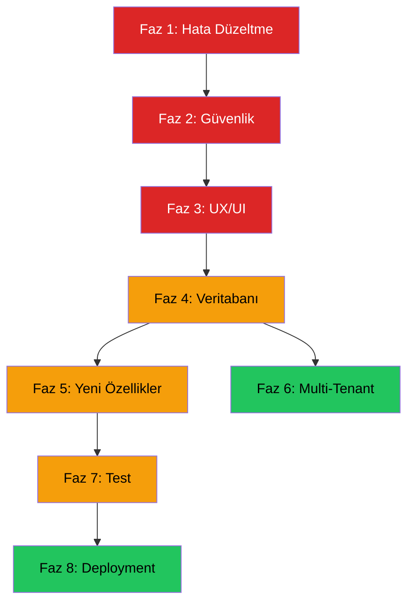

# FabrikaOS (FDYS) — Profesyonelleştirme ve Satışa Hazırlık Planı

## Proje Mevcut Durum Analizi

**FabrikaOS (FDYS)**, Flask tabanlı, SQLite veritabanı kullanan bir **Fabrika Dijital Yönetim Sistemi**dir. Proje, fabrika operasyonlarını dijitalleştirmek için 15 modül içermektedir:

| Modül | Durum | Açıklama |
|-------|-------|----------|
| Kimlik Doğrulama | ✅ Çalışır | 3 rol (yönetici/operatör/teknisyen), hesap kilitleme |
| Dashboard | ✅ Çalışır | Rol bazlı 3 ayrı dashboard |
| Personel Yönetimi | ✅ Çalışır | Çalışan CRUD, vardiya, izin, yetkinlik matrisi |
| Makine & Üretim | ✅ Çalışır | OEE hesaplama, arıza/bakım/duruş takibi |
| Stok Yönetimi | ✅ Çalışır | Malzeme, stok hareketi, tedarikçi |
| Kalite Kontrol | ✅ Çalışır | Hata kayıtları, 8D/CAPA, Pareto |
| Enerji Yönetimi | ✅ Çalışır | Tüketim takibi, karbon ayak izi |
| İSG | ✅ Çalışır | İş kazası, risk değerlendirme, eğitim |
| İş Emri Sistemi | ✅ Çalışır | SLA takibi, Kanban, durum akışı |
| AI Tahminleme | ✅ Çalışır | Kestirimci bakım, OEE/stok tahmini, anomali |
| Analitik | ✅ Çalışır | KPI, korelasyon, maliyet analizi |
| Fabrika Haritası | ✅ Çalışır | SVG tabanlı 2D harita, sürükle-bırak |
| Otomasyon | ✅ Çalışır | 4 kural motoru, akıllı atama |
| Raporlama | ✅ Çalışır | PDF (ISO uyumlu), Excel dışa aktarım |
| Bildirim Sistemi | ✅ Çalışır | SocketIO + polling, 12 tetikleyici |

**Veritabanı**: 22+ tablo, SQLAlchemy ORM, Alembic migrations
**Frontend**: Bootstrap 5.3 Dark Theme, Chart.js, Socket.IO
**Test**: 10 test dosyası (pytest)

---

## Tespit Edilen Hatalar ve Eksiklikler

### 🔴 Kritik Hatalar (Satış Engelleyici)

#### H1 — Duplicate Import Hatası
Birçok dosyada (`kullanici.py`, `makine.py`, `kalite.py`, `bildirim.py`, `dashboard.py`, `auth.py`, `personel.py`, vb.) dosyanın en başında `from datetime import timezone` satırı tek başına duruyor, ardından docstring, sonra tekrar `from datetime import datetime, timezone` var. Bu **duplicate import** hem gereksiz hem de PEP 8 ihlali.

#### H2 — Admin Kullanıcı Düzenleme Hatalı Alan Adları
[admin.py:86-87](file:///c:/Users/scryn/Documents/Projeler/FabrikaOS/app/routes/admin.py#L86-L87) dosyasında:
```python
kullanici.hatali_giris_sayisi = 0  # Model'de alan adı: basarisiz_giris
kullanici.kilit_bitis = None       # Model'de alan adı: kilit_zamani
```
Bu alanlar `Kullanici` modelinde farklı isimlerle tanımlı. **Runtime AttributeError** verecek.

#### H3 — Teknisyen Dashboard'da Yazım Hatası
[dashboard.py:247](file:///c:/Users/scryn/Documents/Projeler/FabrikaOS/app/routes/dashboard.py#L247) dosyasında:
```python
(ArizaKaydi.oncelik == 'kiritik', 1),  # "kritik" olması lazım
```

#### H4 — PDF Generator Windows Font Bağımlılığı
[pdf_generator.py:15-18](file:///c:/Users/scryn/Documents/Projeler/FabrikaOS/app/utils/pdf_generator.py#L15-L18) dosyasında Arial fontları `C:\\Windows\\Fonts\\` hard-coded. Linux/macOS'ta çalışmaz, müşteri ortamına taşınabilirlik problemi.

#### H5 — `is_emri_servisi` Return Objesinde `numara` Yerine `is_emri_no`
[otomasyon_motoru.py:109](file:///c:/Users/scryn/Documents/Projeler/FabrikaOS/app/services/otomasyon_motoru.py#L109) dosyasında `sonuc.numara` kullanılıyor ama `IsEmri` modelinde böyle bir alan yok; doğrusu `sonuc.is_emri_no`.

#### H6 — SLA Eskalasyon Mesajında Yazım Hatası
[is_emri_servisi.py:438](file:///c:/Users/scryn/Documents/Projeler/FabrikaOS/app/services/is_emri_servisi.py#L438): `"ESKALASYİON"` → `"ESKALASYON"` yazım hatası.

#### H7 — `cors_allowed_origins="*"` Güvenlik Açığı
[__init__.py:70](file:///c:/Users/scryn/Documents/Projeler/FabrikaOS/app/__init__.py#L70): SocketIO'da tüm origin'lere izin verilmiş. Production'da güvenlik riski.

#### H8 — Secret Key Hardcoded
[config.py:20](file:///c:/Users/scryn/Documents/Projeler/FabrikaOS/config.py#L20): `'degistir-bu-anahtari-uretimde'` fallback değeri production'da kalabilir. Uyarı var ama engelleme yok.

---

### 🟡 Orta Seviye Sorunlar

#### S1 — Pagination Eksikliği
Bazı sayfalarda tüm kayıtlar `.all()` ile çekiliyor (ISG olayları, risk değerlendirmeleri, tedarikçiler). Veri büyüdüğünde performans sorunu.

#### S2 — Silme İşlemleri İçin Confirmation Modal Eksik
Çalışan silme, vardiya silme, KPI silme gibi işlemlerde onay modalı yok. Yanlışlıkla silme riski.

#### S3 — Input Validasyon Eksiklikleri
- Arama kutularında SQL injection koruması sadece ORM'e güveniyor (yeterli ama `ilike` kullanımı kontrol edilmeli)
- Dosya yükleme validasyonu sadece uzantı kontrolü — MIME type kontrolü yok
- Bazı form alanlarında client-side validation eksik

#### S4 — Error Handling Tutarsızlığı
Birçok yerde `except Exception: pass` kullanılıyor. Hata loglanmıyor, sorun tespiti zorlaşıyor.

#### S5 — Bildirim Spam Riski
`bildirim_motoru.py`'deki bazı metotlar (stok_kontrol, oee_kontrol) her çağrıldığında yeni bildirim oluşturuyor. Tekrar engelleme sadece AI modülünde var.

#### S6 — SQLite Production Kısıtlaması
SQLite tek yazıcı limiti, concurrent kullanıcı desteği zayıf. Fabrika ortamında 20+ kullanıcı ile sorun olacak.

#### S7 — Şifre Değiştirme Özelliği Yok
Kullanıcılar kendi şifrelerini değiştiremiyorlar. Sadece admin değiştirebilir.

#### S8 — Oturum Timeout Uyarısı Yok
8 saatlik session timeout var ama kullanıcıya uyarı verilmiyor, aniden login sayfasına yönlendirilir.

---

### 🟢 İyileştirme Alanları

#### I1 — Responsive Tasarım Eksik
Sidebar mobile'da hamburger menüye dönmüyor. Tablet ve telefon desteği yetersiz.

#### I2 — Loading State'ler Yok
Form submit, AJAX çağrıları sırasında kullanıcıya görsel geri bildirim (spinner/skeleton) yok.

#### I3 — Veri Dışa/İçe Aktarım
Excel import özelliği yok. Toplu veri girişi yapılamıyor.

#### I4 — Çoklu Dil Desteği Yok
Sistem sadece Türkçe. Uluslararası satış potansiyeli kısıtlı.

#### I5 — API Dokümantasyonu Yok
REST API endpoint'leri var ama Swagger/OpenAPI dokümantasyonu yok.

---

## Profesyonelleştirme Planı — 8 Faz

> [!IMPORTANT]
> Aşağıdaki fazlar öncelik sırasına göre sıralanmıştır. İlk 3 faz **satış öncesi zorunlu**, diğerleri **rekabet avantajı** sağlayacak özelliklerdir.

---

### Faz 1 — Kritik Hata Düzeltmeleri ve Kod Kalitesi ⚡
**Süre tahmini**: 1-2 gün
**Öncelik**: 🔴 ZORUNLU

#### Yapılacaklar:
1. **Tüm duplicate import'ları temizle** (H1) — ~15 dosya
2. **Admin kullanıcı düzenleme hatalarını düzelt** (H2) — `hatali_giris_sayisi` → `basarisiz_giris`, `kilit_bitis` → `kilit_zamani`
3. **Teknisyen dashboard yazım hatası** (H3) — `'kiritik'` → `'kritik'`
4. **Otomasyon motoru `numara` hatası** (H5) — `sonuc.numara` → `sonuc.is_emri_no`
5. **SLA eskalasyon yazım hatası** (H6) — `ESKALASYİON` → `ESKALASYON`
6. **Tüm `except Exception: pass` bloklarını loglama ile değiştir** (S4)
7. **`allow_unsafe_werkzeug=True` uyarısını production config'de kaldır**

---

### Faz 2 — Güvenlik Sıkılaştırma 🔒
**Süre tahmini**: 2-3 gün
**Öncelik**: 🔴 ZORUNLU

#### Yapılacaklar:
1. **Secret Key zorunlu yapma** — Production'da env variable yoksa uygulama başlamasın
2. **CORS origin kısıtlaması** (H7) — `cors_allowed_origins` yapılandırılabilir yap
3. **Dosya yükleme güvenliği** — MIME type kontrolü, dosya boyutu doğrulama, magic bytes kontrolü
4. **Şifre politikası güçlendirme** — Minimum büyük/küçük harf, rakam, özel karakter kontrolü
5. **Kullanıcı kendi şifresini değiştirme** özelliği ekle (S7)
6. **CSRF token yenileme** — AJAX isteklerinde otomatik CSRF token yenileme
7. **Rate limiting iyileştirme** — Login dışında API endpoint'lerine de rate limit
8. **Session timeout uyarısı** (S8) — Son 5 dakikada modal uyarı
9. **XSS koruması** — Template'lerde `|safe` filtresinin gereksiz kullanımını kontrol et
10. **HTTP güvenlik başlıkları** — `X-Content-Type-Options`, `X-Frame-Options`, `Content-Security-Policy`

---

### Faz 3 — UX/UI Profesyonelleştirme 🎨
**Süre tahmini**: 3-4 gün
**Öncelik**: 🔴 ZORUNLU

#### Yapılacaklar:
1. **Responsive sidebar** (I1) — Mobile hamburger menü, tablet uyumu
2. **Loading state'ler** (I2) — Form submit spinner, AJAX skeleton loader
3. **Silme onay modalları** (S2) — Tüm silme işlemleri için Bootstrap modal
4. **Toast bildirimleri** — Başarı/hata mesajları için modern toast UI
5. **Form validation iyileştirme** — Real-time client-side validation
6. **Empty state tasarımları** — Veri yokken güzel boş durum ekranları
7. **Breadcrumb navigasyonu** — Tüm alt sayfalarda konum göstergesi
8. **Data table geliştirmeleri** — Sıralama, arama, sayfa başına kayıt seçimi
9. **Keyboard shortcut'lar** — Hızlı navigasyon (Ctrl+N yeni kayıt vb.)
10. **Profil sayfası zenginleştirme** — Kullanıcı profil fotoğrafı, aktivite geçmişi
11. **Login sayfası profesyonelleştirme** — Firma logosu, arka plan animasyonu
12. **Dark/Light mode toggle** — Kullanıcı tercihi ile tema değişimi

---

### Faz 4 — Veri Bütünlüğü ve Veritabanı 🗄️
**Süre tahmini**: 2-3 gün
**Öncelik**: 🟡 YÜKSEK

#### Yapılacaklar:
1. **PostgreSQL desteği** (S6) — SQLite'a ek olarak PostgreSQL driver ve config
2. **Database connection pooling** — SQLAlchemy pool ayarları
3. **Soft delete tutarlılığı** — Tüm modellerde `aktif` alanı standardizasyonu
4. **Veri bütünlüğü kısıtlamaları** — Foreign key cascade kurallarını gözden geçir
5. **Index optimizasyonu** — Yavaş sorguları tespit et, gerekli index'leri ekle
6. **Pagination standardizasyonu** (S1) — Tüm liste sayfalarında pagination
7. **Database migration testi** — Mevcut migration'ların çalıştığından emin ol
8. **Veri yedekleme UI** — Admin panelinden yedekleme başlatma/indirme
9. **Seed data iyileştirmesi** — Demo veri setini zenginleştir, tutarlı hale getir

---

### Faz 5 — Yeni Özellikler (Satış Değeri Artırıcı) ✨
**Süre tahmini**: 5-7 gün
**Öncelik**: 🟡 YÜKSEK

#### 5.1 — Excel/CSV Import Özelliği
- Malzeme, çalışan, makine toplu yükleme
- Şablon dosyası indirme
- Import validation ve hata raporu

#### 5.2 — Gelişmiş Dashboard Widget'ları
- Sürükle-bırak dashboard düzeni (kullanıcı özelleştirmesi)
- Gerçek zamanlı OEE gaugemetre
- Canlı üretim sayacı

#### 5.3 — E-posta Bildirim Desteği
- SMTP yapılandırması (admin panelinden)
- Kritik uyarılarda e-posta gönderimi
- Günlük/haftalık özet rapor e-postası

#### 5.4 — Gelişmiş Raporlama
- Tarih aralığı filtrelemeli raporlar
- Karşılaştırmalı rapor (bu ay vs geçen ay)
- Özel rapor oluşturma arayüzü
- Rapor zamanlama (otomatik günlük/haftalık)

#### 5.5 — Dosya Yönetimi
- Her kayıta dosya/fotoğraf ekleme (arıza fotoğrafı, bakım raporu vb.)
- Dosya önizleme ve galeri görünümü

#### 5.6 — Takvim Görünümü
- Bakım takvimi (FullCalendar.js entegrasyonu)
- Vardiya takvimi görsel düzenleme
- İzin takvimi

#### 5.7 — Çalışan Self-Service Portal
- Operatör/Teknisyen kendi izin taleplerini görebilmeli
- Kendi vardiya programını görebilmeli
- Kendi üretim performansını görebilmeli

---

### Faz 6 — Multi-Tenant ve Lisanslama 🏢
**Süre tahmini**: 5-7 gün
**Öncelik**: 🟢 ORTA (Satış modeline bağlı)

#### Yapılacaklar:
1. **Çoklu fabrika desteği** — Tenant-based veri izolasyonu
2. **Lisans yönetimi** — License key sistemi, son kullanma tarihi
3. **Modül bazlı lisanslama** — Müşteriye göre aktif modül seçimi
4. **White-label desteği** — Logo, renk, uygulama adı özelleştirme
5. **Kullanıcı limiti** — Lisansa göre maksimum kullanıcı sayısı
6. **Kurulum sihirbazı** — İlk kurulumda adım adım yapılandırma
7. **Otomatik güncelleme** — Versiyon kontrolü ve güncelleme bildirimi

---

### Faz 7 — Test ve Kalite Güvence ✅
**Süre tahmini**: 3-4 gün
**Öncelik**: 🟡 YÜKSEK

#### Yapılacaklar:
1. **Test coverage artırımı** — Hedef: %80+ coverage
2. **Entegrasyon testleri** — Tüm CRUD operasyonları için
3. **UI testleri** — Selenium/Playwright ile kritik akışlar
4. **Yük testi** — Locust ile 50+ concurrent kullanıcı testi
5. **Güvenlik testi** — OWASP Top 10 kontrolü (mevcut doküman var, gerçek test yapılmalı)
6. **Cross-browser testi** — Chrome, Firefox, Edge uyumu
7. **Hata izleme** — Sentry veya benzeri error tracking entegrasyonu
8. **Logging standardizasyonu** — Yapılandırılmış loglama (JSON format), log rotation

---

### Faz 8 — Deployment ve DevOps 🚀
**Süre tahmini**: 2-3 gün
**Öncelik**: 🟢 ORTA

#### Yapılacaklar:
1. **Docker containerization** — Dockerfile + docker-compose.yml
2. **Nginx reverse proxy** yapılandırması
3. **SSL/TLS sertifika** desteği (Let's Encrypt)
4. **Health check endpoint** — `/api/health` durumu
5. **Monitoring dashboard** — Prometheus + Grafana veya basit health page
6. **CI/CD pipeline** — GitHub Actions ile otomatik test/deploy
7. **Ortam değişkenleri dokümantasyonu** — `.env.example` dosyası
8. **Kurulum script'i** — Tek komutla kurulum (Windows + Linux)
9. **Kullanıcı dokümantasyonu** — Online yardım sayfaları

---

## Öncelik Matrisi



## Toplam Tahmini Süre

| Faz | Süre | Öncelik |
|-----|------|---------|
| Faz 1 — Hata Düzeltme | 1-2 gün | 🔴 Zorunlu |
| Faz 2 — Güvenlik | 2-3 gün | 🔴 Zorunlu |
| Faz 3 — UX/UI | 3-4 gün | 🔴 Zorunlu |
| Faz 4 — Veritabanı | 2-3 gün | 🟡 Yüksek |
| Faz 5 — Yeni Özellikler | 5-7 gün | 🟡 Yüksek |
| Faz 6 — Multi-Tenant | 5-7 gün | 🟢 Orta |
| Faz 7 — Test | 3-4 gün | 🟡 Yüksek |
| Faz 8 — Deployment | 2-3 gün | 🟢 Orta |
| **TOPLAM** | **23-33 gün** | |

> [!WARNING]
> **Faz 1-3 satış öncesi kesinlikle tamamlanmalıdır.** Özellikle H2 (admin kullanıcı düzenleme hatası) ve H3 (teknisyen dashboard hatası) canlı ortamda runtime hatalarına neden olacaktır.

## Open Questions

> [!IMPORTANT]
> 1. **Veritabanı Tercihi**: Ürünü SQLite ile mi satmayı planlıyorsun, yoksa PostgreSQL/MySQL'e geçmeli miyiz? SQLite küçük fabrikalar (<20 kullanıcı) için yeterli ama büyük fabrikalar için yetersiz kalabilir.

> [!IMPORTANT]
> 2. **Satış Modeli**: SaaS (bulut) mı yoksa on-premise (müşteri sunucusu) mu? Bu Multi-Tenant ve deployment stratejisini doğrudan etkiler.

> [!IMPORTANT]
> 3. **Çoklu Dil**: Sadece Türkiye pazarı mı hedefleniyor? Çoklu dil desteği eklenecek mi?

> [!IMPORTANT]
> 4. **Hangi fazlardan başlamamı istersin?** Hepsini sırayla mı yapalım, yoksa belirli fazları önceliklendirelim mi?
